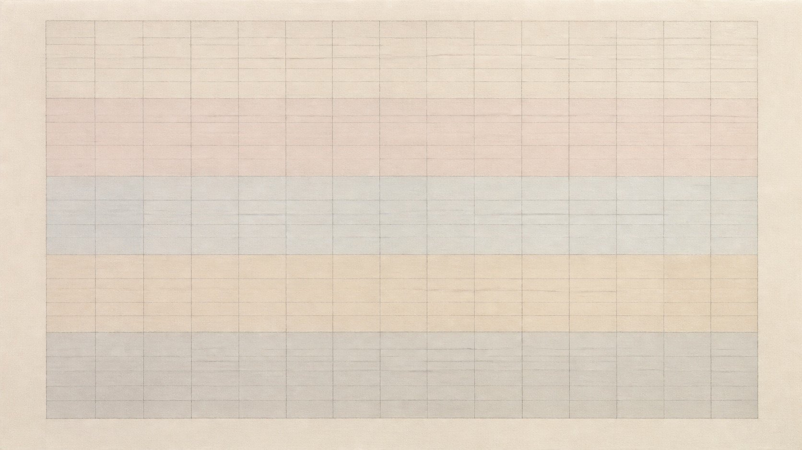

# 艾格尼丝·马丁

[English](README.en.md)



> **分类：** 艺术家
> **媒介领域：** 绘画
> **目录：** `style-packages/artists/agnes-martin`

## 简介

以极细网格、重复线条、低对比色带和安静留白构成极简绘画，强调手绘重复中的微小偏差与长时间观看。

这是一个可独立使用的风格包。它把可观察的媒介、构图、光线、色彩、表面、纹理和复现步骤整理成可执行规则，用于生成新的主题，不用于复制某一件具体作品。

## 策展短评

我会先看“以极细网格、重复线条、低对比色带和安静留白构成极简绘画，强调手绘重复中的微小偏差与长时间观看”。它把观看节奏定下来，题材可以按你的需要替换。

## 使用前先看

- `identity.yaml`：范围、对象和排除项
- `visual-signature.yaml`：跨主题仍应保持的视觉特征
- `reproduction.yaml`：媒介、材料和构建顺序
- `prompts/base.txt`、`prompts/negative.txt`：基础 Prompt 与负面约束
- `palette/palette.json`：色彩角色与色值
- `evaluation.yaml`：生成后的检查标准
- `references/manifest.csv`、`provenance.yaml`：来源和权利边界

## 来源与版权

参考资料只用于研究和分析。外部作品、摄影作品、游戏画面、商标和平台页面仍归原权利人所有。生成示例是新的匿名场景，不是相关艺术家、摄影师、流派、学校或游戏的原作，也不代表合作、授权或背书关系。

详细来源和再分发边界见 [`provenance.yaml`](provenance.yaml)、[`references/manifest.csv`](references/manifest.csv) 以及仓库根目录的 [`NOTICE`](../../../NOTICE)。

## 只使用此包

四种方式可以按手边工具任选其一，不需要同时使用。

### 方式一：交给有生图能力的 Agent

把整个风格包目录上传给 Agent，或把本地目录路径交给它，并附上：

```text
请使用这个风格包帮助我生成图片。

请先读取本目录中的 identity.yaml、visual-signature.yaml、reproduction.yaml、
prompts/base.txt、prompts/negative.txt、palette/palette.json 和 evaluation.yaml。
请把文件中的规则整合到生成流程中，不要只把风格名称当作 Prompt，也不要复制参考作品。

我的生成需求是：
<填写人物、物体、场景、画幅和用途>

请先编译完整 Prompt，再调用你的生图能力。生成后按照 evaluation.yaml 检查风格特征、
构图、颜色、材质、AI 痕迹和需求遵循度，并说明仍然存在的风险。
```

### 方式二：直接复制 Prompt

打开 `prompts/base.txt`，替换主题、人物、物体、场景和画幅；将 `prompts/negative.txt` 作为负面 Prompt 一并提交到支持文本生图的平台。需要更稳定时，同时参考视觉签名和调色板。

### 方式三：配置 API Key 后提交生成

在你自己的生图平台或编译工具中配置 API Key，将基础 Prompt、负面约束、调色板和必要的参考清单一起提交。API Key 只保存在你的环境中；本仓库不代管密钥、不托管在线生图服务，也不承诺某个平台的免费额度或接口兼容性。

### 方式四：本地模型 + ComfyUI

将基础 Prompt 和负面约束接入本地模型或 ComfyUI 工作流；按调色板、复现说明和参考清单设置颜色、构图、材质与光线。生成后用 `evaluation.yaml` 做人工或自动复核。

模型权重、API Key 和生成图片由使用者自行管理。参考图只用于理解可观察特征，不要复制原作的具体构图、人物、文字、商标或标志。

## 新架构：手绘网格色域（实验）

[`art-direction.yaml`](art-direction.yaml) 使用方向格式 2.1.0，仅适用于非具象的抽象色域：用细铅笔线或克制的平行线组织低对比画面，保留手工线条的轻微偏差。需显式声明 `abstract-field` 上下文；只有调用者再声明 `close-view-of-painted-surface` 时，才启用强调薄涂色层和支撑材质细节的近看规则。它与包豪斯的高对比基本形和功能构成不同；不能拿来把人物、场景转成“网格风”。

```powershell
python tools/compile-style.py style-packages/artists/agnes-martin --direction package --context abstract-field --subject "A quiet nonfigurative square field of pale blue and warm gray" --output runs/style-v2/agnes-martin-job.json
```

方向仍处于实验状态。古根海姆和 MoMA 的资料支持其手绘网格、柔和色域与线条微差的观察；它对题材的限制也已写入范围契约。

## 新旧架构视觉对照

查看[同题样图、编译任务和复核限制](comparisons/README.md)。该对照是单题材初步检查，方向仍处于实验状态。
