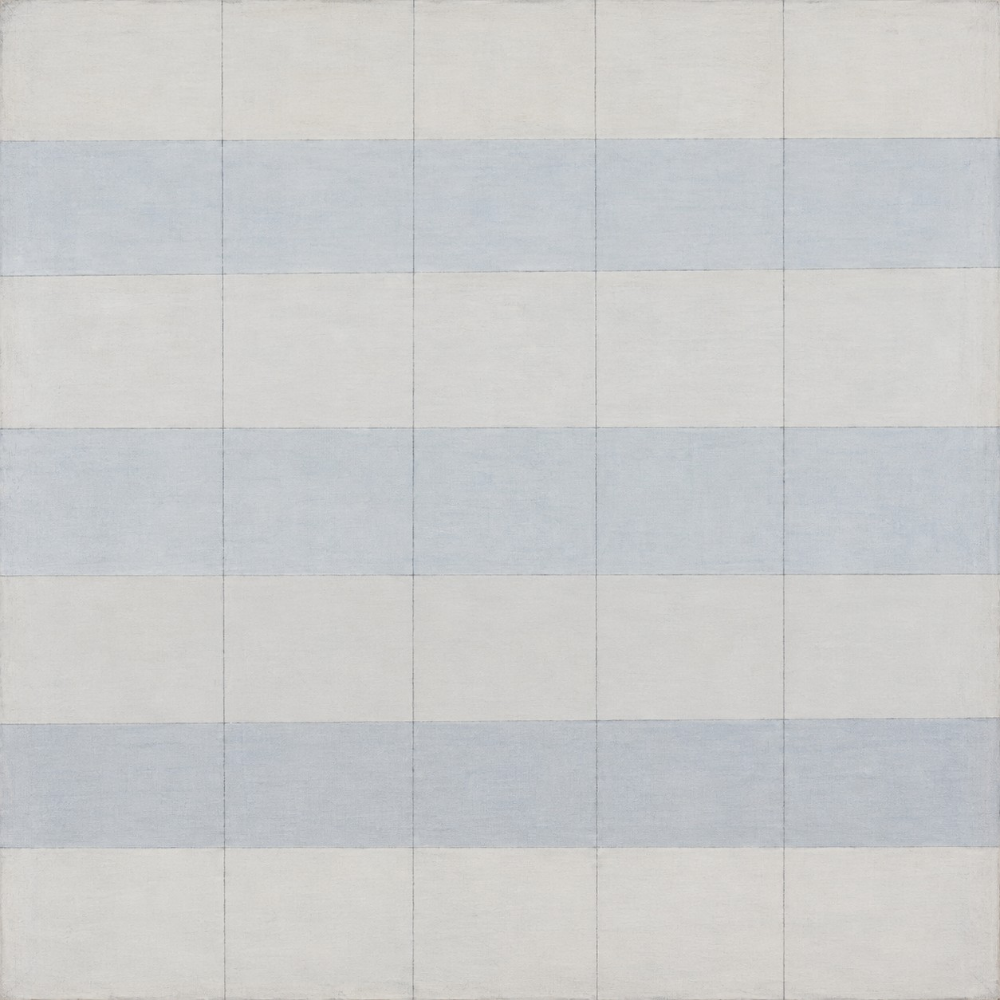
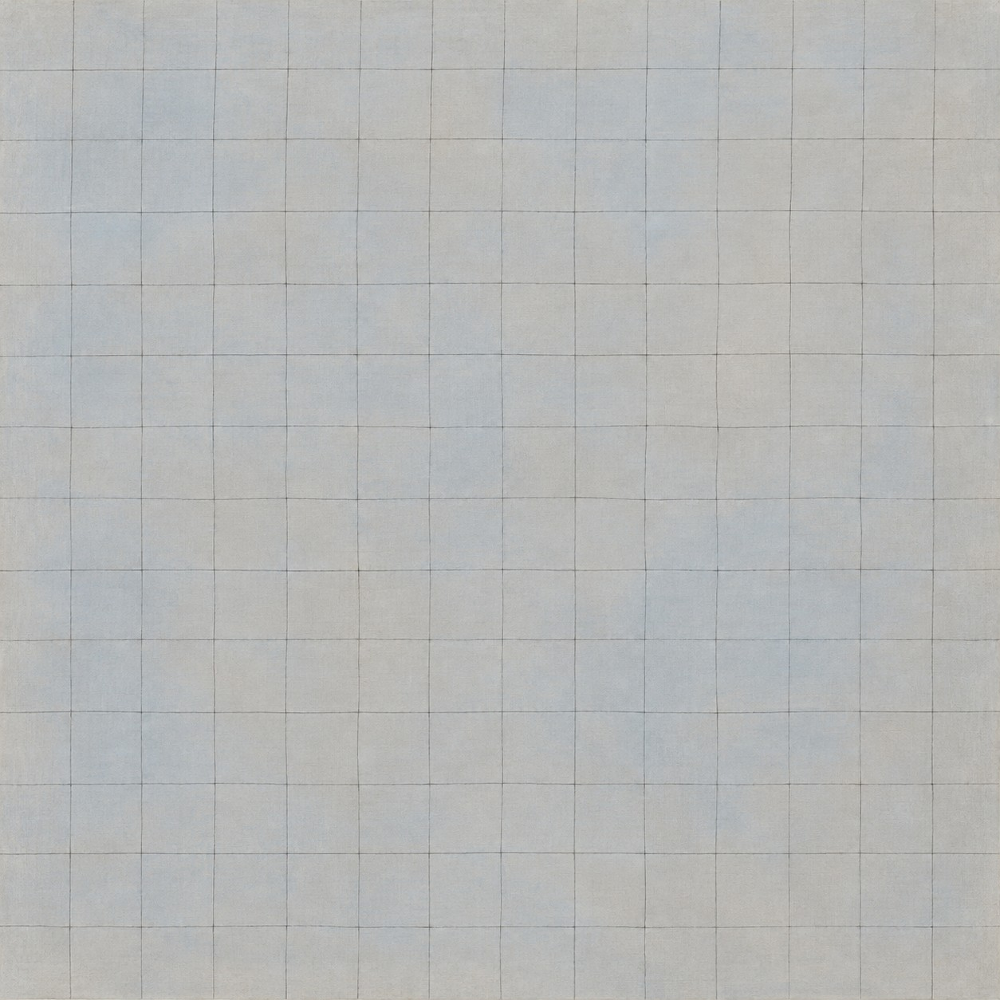

# 新旧架构视觉对照

| 旧版包默认规则 | 新版方向规则 |
|---|---|
|  |  |

- **同一输入主题：** `A quiet nonfigurative square field of pale blue and warm gray`
- **图像形式：** 两张独立成图。
- **任务记录：** [旧版编译任务](legacy-job.json)、[新版方向编译任务](direction-job.json)。
- **人工复核：** 两图均为浅蓝与暖灰组成的方形抽象网格。旧版以约五条宽水平色带构成大尺度节奏，线格较疏；新版把网格明显细分为更多窄单元，线条更密，灰蓝底色也更均匀。两者都保留低对比、克制的网格场，但新版改变了网格密度这一核心形式。该差异可见；单张静态样本不能评估微小偏差和长系列一致性。
- **限制：** 两版由独立生图调用完成，没有固定随机种子，不能单独证明差异由架构规则造成，也不能证明规则跨题材稳定。包状态继续保持 `experimental`，需要更多主题与人工复核。
