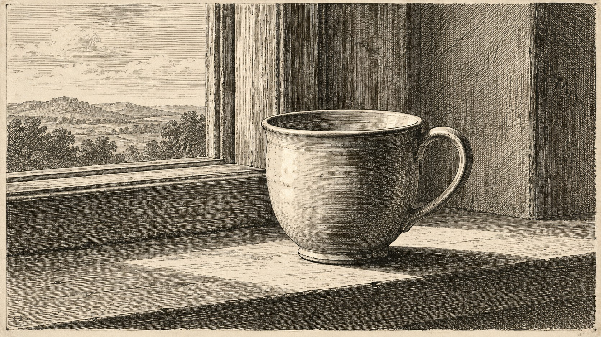
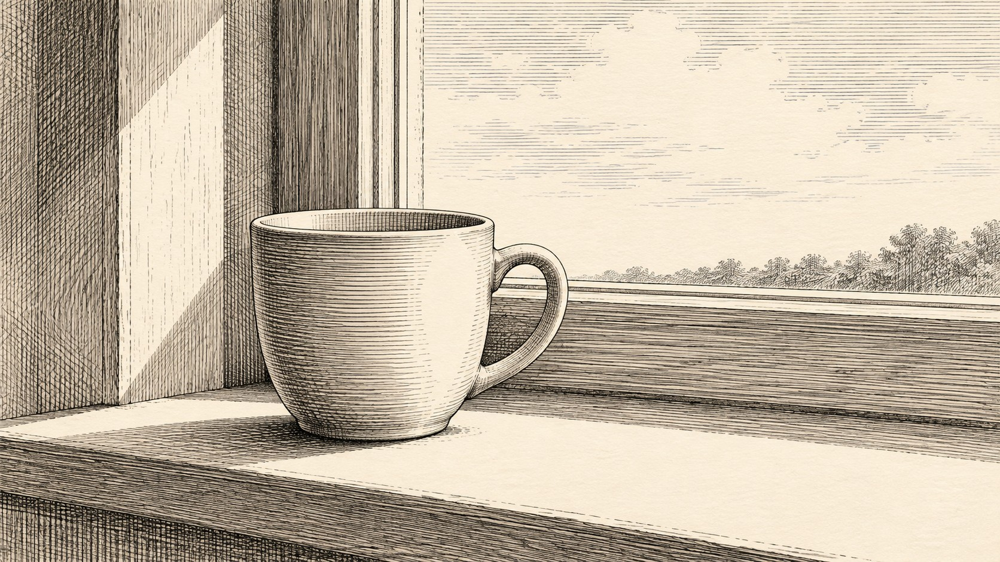

# 新旧架构视觉对照

| 旧版包默认规则 | 新版方向规则 |
|---|---|
|  |  |

- **同一输入主题：** `An ordinary ceramic cup on a windowsill`
- **任务记录：** [旧版编译任务](legacy-job.json)、[新版方向编译任务](direction-job.json)。
- **人工复核：** 两图都描绘窗台上的单只陶杯，并采用黑白交叉排线。旧版让杯子占据画面中央偏右，窗外风景和木纹排线密集；新版把杯子缩小并移向左侧，右侧留出更多明亮窗面，阴影与木纹线条更疏。主体和材料可辨，版画式排线保留。主要差异落在裁切和留白；单样本尚不足以证明更具杜勒特征的结构素描能力。
- **限制：** 两版来自独立生图调用，没有固定随机种子，不能单独证明差异由架构规则造成，也不能证明规则跨题材稳定。包状态继续保持 `experimental`。
