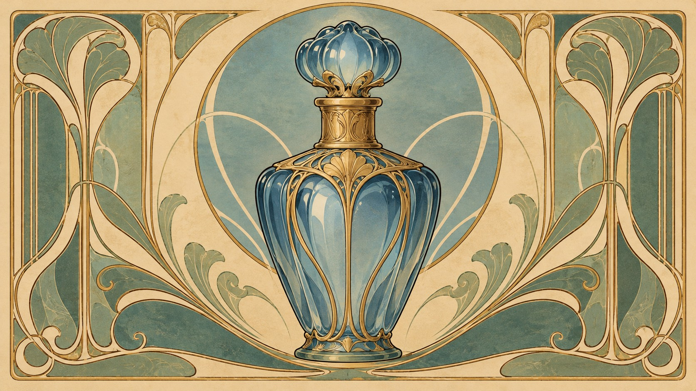
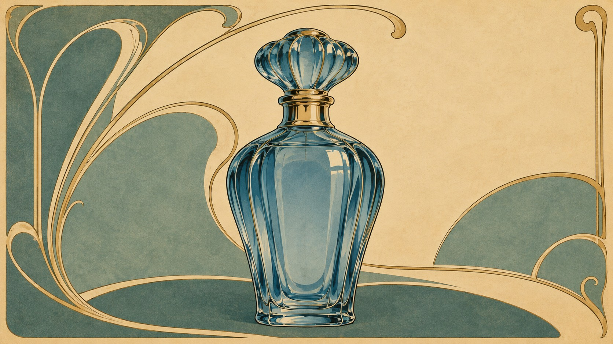

# 新旧架构视觉对照

| 旧版包默认规则 | 新版方向规则 |
|---|---|
|  |  |

- **同一输入主题：** `A blue glass perfume bottle in a decorative poster, no lettering`
- **任务记录：** [旧版编译任务](legacy-job.json)、[新版方向编译任务](direction-job.json)。
- **人工复核：** 两图均以无字装饰海报呈现蓝色玻璃香水瓶，主体数量一致。旧版近似左右对称的完整画框，瓶身由花饰与密集曲线包围；新版保留新艺术风格的弧线边框和金绿色配色，但改成偏左的大瓶与右侧大面积留白，装饰线条更少。主题和无文字约束满足；新版的非对称构图让瓶子突出，却削弱了旧版的整体装饰密度，因此只能确认构图变化，不能断言方向更接近慕夏。
- **限制：** 两版来自独立生图调用，没有固定随机种子，不能单独证明差异由架构规则造成，也不能证明规则跨题材稳定。包状态继续保持 `experimental`。
