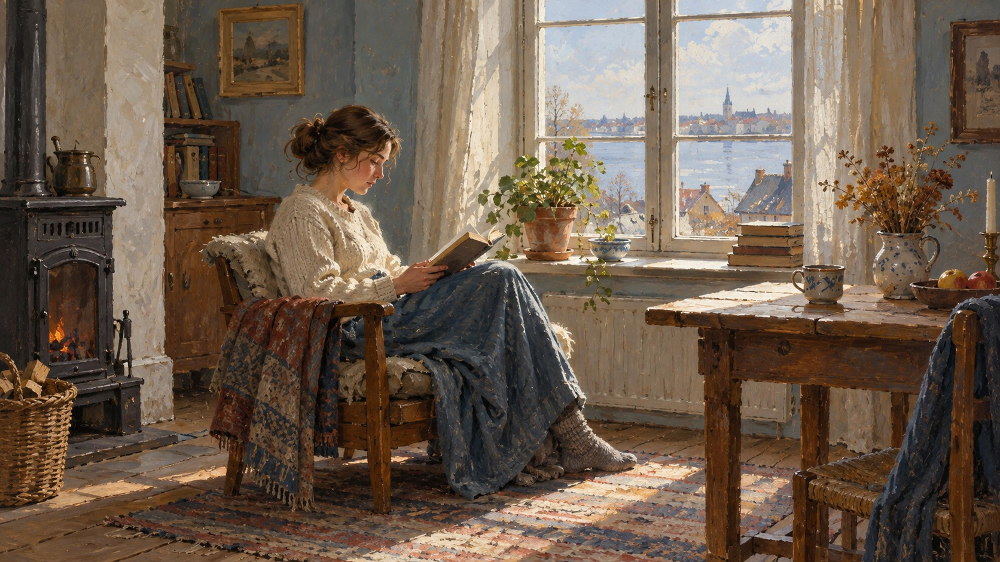
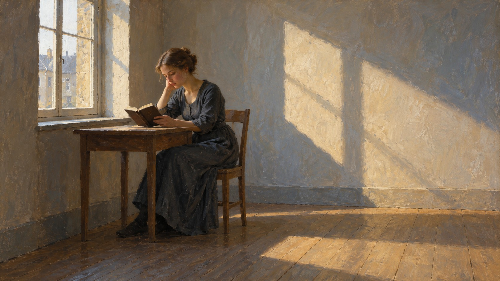

# 新旧架构视觉对照

| 旧版包默认规则 | 新版方向规则 |
|---|---|
|  |  |

- **同一输入主题：** `A woman reading beside a window in a quiet room`
- **图像形式：** 两张独立成图。
- **任务记录：** [旧版编译任务](legacy-job.json)、[新版方向编译任务](direction-job.json)。
- **人工复核：** 两图都表现安静室内窗边读书的女性。旧版是横向展开的完整房间，人物居中偏左，窗外城景及桌面、炉具等细节构成生活环境；新版人物更小并靠左，背景简化为大片空墙与地板光影。读书动作与窗边环境仍可辨，光线保持柔和；新版出现明显留白与简化，但构图与旧版差异较大，不能把全部变化归因于风格规则。
- **限制：** 两版由独立生图调用完成，没有固定随机种子，不能单独证明差异由架构规则造成，也不能证明规则跨题材稳定。包状态继续保持 `experimental`，需要更多主题与人工复核。
