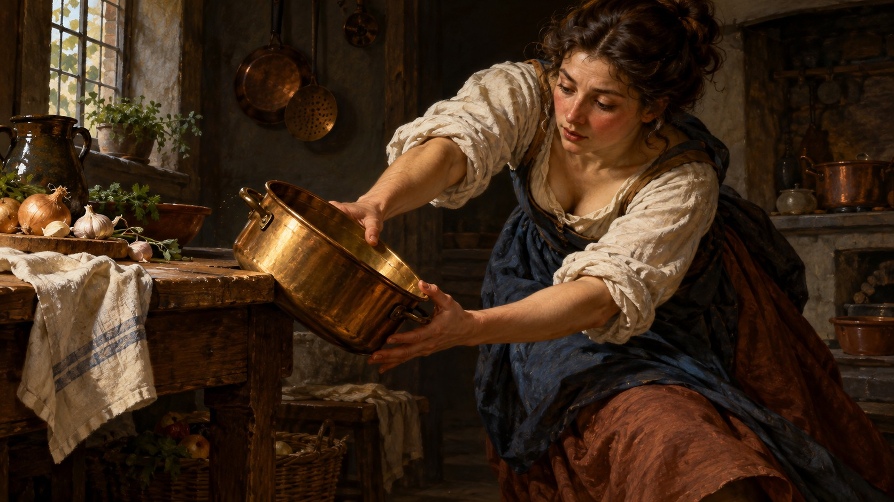

# 新旧架构视觉对照

| 旧版包默认规则 | 新版方向规则 |
|---|---|
|  |  |

- **同一输入主题：** `A person catching a brass pot before it falls in a dim kitchen`
- **图像形式：** 两张独立成图。
- **任务记录：** [旧版编译任务](legacy-job.json)、[新版方向编译任务](direction-job.json)。
- **人工复核：** 两图都保留昏暗厨房、人物与一只黄铜锅。旧版人物以单臂伸向倾倒的锅，明亮手臂和锅身从大块暗部中突出；新版用双手托住锅，人物和锅的位置反转，锅已更稳定，动作瞬间不再完全相同。两版都采用强明暗对照，新版的亮部集中和暗背景清楚，但动作时刻偏离原题，不能作为严格同一动作的有效配对；后续应重做主体对齐后再评估。
- **限制：** 两版由独立生图调用完成，没有固定随机种子，不能单独证明差异由架构规则造成，也不能证明规则跨题材稳定。包状态继续保持 `experimental`，需要更多主题与人工复核。
