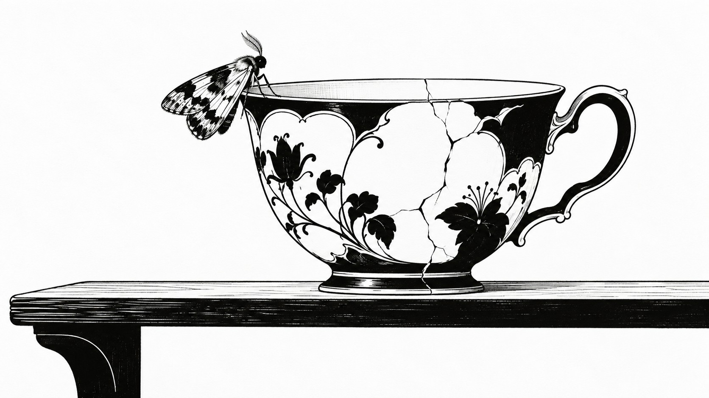
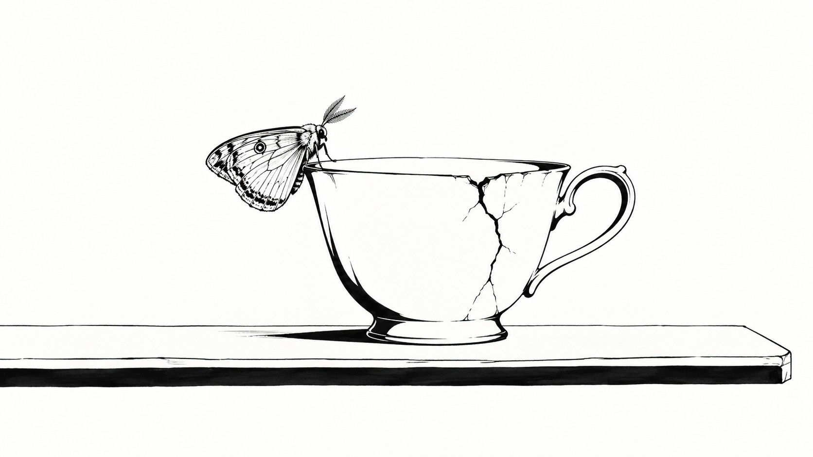

# 新旧架构视觉对照

| 旧版包默认规则 | 新版方向规则 |
|---|---|
|  |  |

- **同一输入主题：** `A small moth resting on a cracked teacup on a plain shelf`
- **图像形式：** 两张独立成图。
- **任务记录：** [旧版编译任务](legacy-job.json)、[新版方向编译任务](direction-job.json)。
- **人工复核：** 两图均保留裂纹茶杯、杯沿上的小飞蛾和空置搁板。旧版在杯身铺满花饰与密集黑色块面；新版删去大部分杯身纹样，改用更少的流畅粗细线、清楚的裂纹和大面积纸白，主体边缘更轻。新版负形更突出，符合黑白墨块与留白方向；不过旧版的黑色占比和装饰细节更强。此样例可见规则差异，尚不能判断哪一版跨题材更稳定。
- **限制：** 两版由独立生图调用完成，没有固定随机种子，不能单独证明差异由架构规则造成，也不能证明规则跨题材稳定。包状态继续保持 `experimental`，需要更多主题与人工复核。
