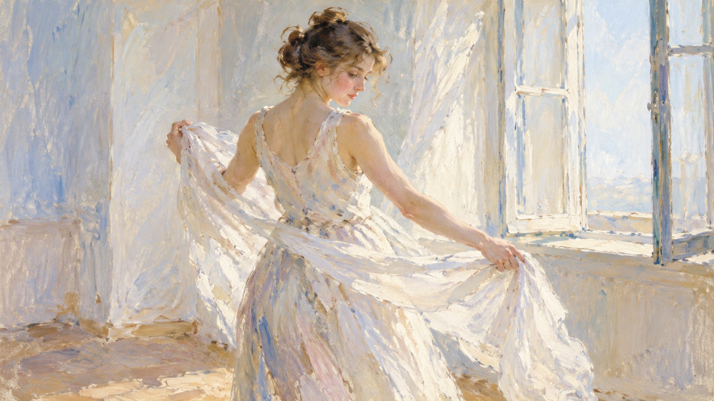

# 新旧架构视觉对照

| 旧版包默认规则 | 新版方向规则 |
|---|---|
|  |  |

- **同一输入主题：** `A person turning while holding a loose white scarf beside an open window`
- **图像形式：** 两张独立成图。
- **任务记录：** [旧版编译任务](legacy-job.json)、[新版方向编译任务](direction-job.json)。
- **人工复核：** 两图都表现人物在开窗旁转身并展开白围巾。旧版是宽幅全身场景，人物和布料被浅色笔触铺满；新版裁切更近，围巾斜向横跨画面，人物转身动作更集中，部分背景边缘留成稀疏底色，笔触方向也随布料变化。题目中的人物、窗与围巾保留。新版更贴合“动作与布料带动笔触、局部开放边缘”的规则；近景裁切变化较大，单次结果无法区分规则效果与采样差异。
- **限制：** 两版由独立生图调用完成，没有固定随机种子，不能单独证明差异由架构规则造成，也不能证明规则跨题材稳定。包状态继续保持 `experimental`，需要更多主题与人工复核。
