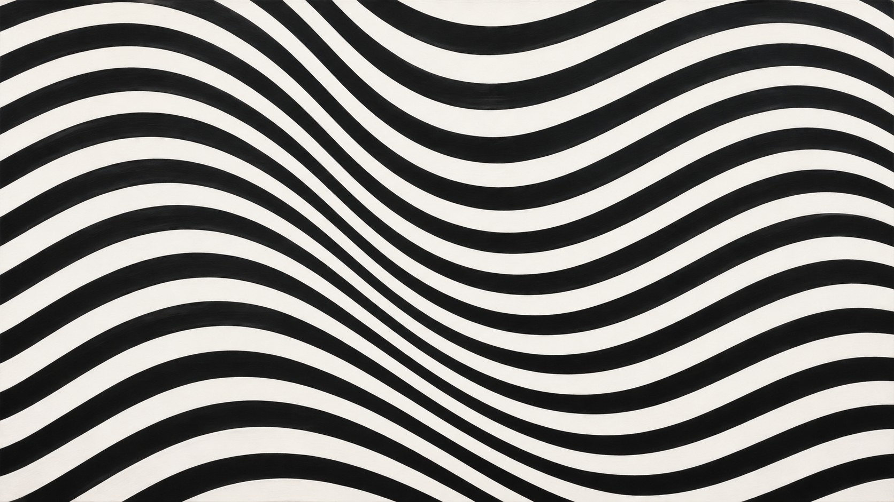

# 新旧架构视觉对照

| 旧版包默认规则 | 新版方向规则 |
|---|---|
|  |  |

- **同一输入主题：** `A field of curved black and white bands with a gradual wave`
- **任务记录：** [旧版编译任务](legacy-job.json)、[新版方向编译任务](direction-job.json)。
- **人工复核：** 两图都保持黑白弯曲条带构成的单一平面，没有透视走廊或投影。旧版在左侧形成明显的条带聚拢和宽度变化；新版主要是较均匀的波浪带，间距和宽度的序列变化较弱。新版保留清晰边缘与平面性，但没有稳定体现方向规则要求的受控几何递变；旧版反而有更强的收束。该样本不应视为新版核心规则通过，需强化递变说明并重做输出。
- **限制：** 两版来自独立生图调用，没有固定随机种子，不能单独证明差异由架构规则造成，也不能证明规则跨题材稳定。包状态继续保持 `experimental`。
