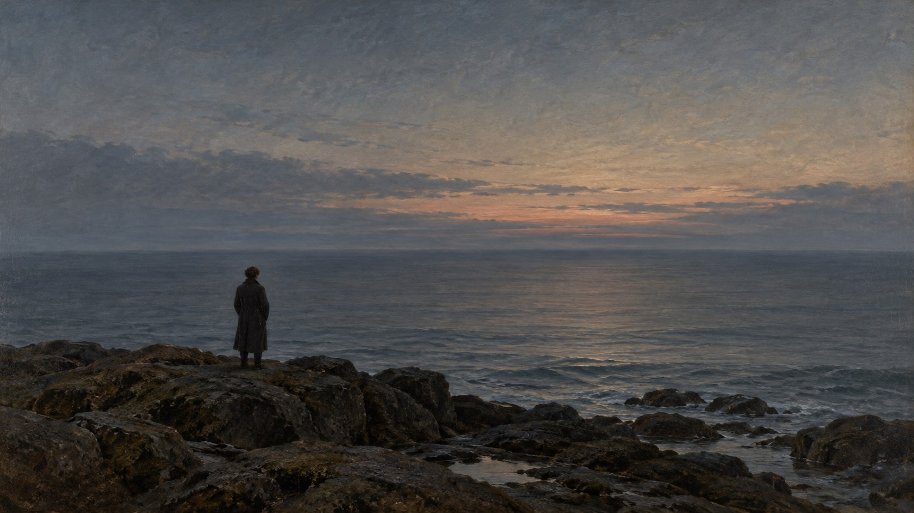
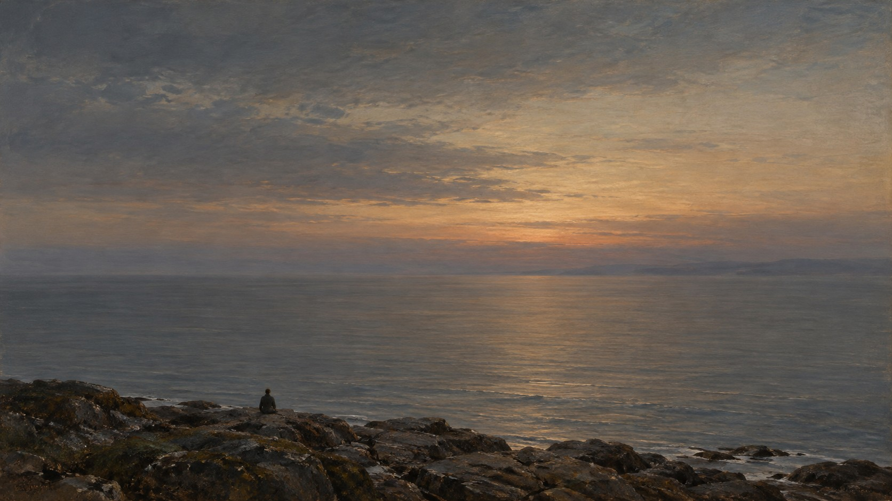

# 新旧架构视觉对照

| 旧版包默认规则 | 新版方向规则 |
|---|---|
|  |  |

- **同一输入主题：** `A small person seen from behind on a rocky shore at dusk, looking across a broad quiet sea`
- **任务记录：** [旧版编译任务](legacy-job.json)、[新版方向编译任务](direction-job.json)。
- **人工复核：** 两图都保留背向观海的小人物、岩岸、暮色和广阔海面。旧版人物偏左且较大，近景岩石占据较多画幅；新版人物缩得更小并接近中央下缘，天空和海面的空阔比例增加，前景岩石也更集中。尺度关系因此更直接，符合以人物衡量自然空间的方向；新版人物姿态似乎变为坐姿，原题未指定站坐，主体约束仍成立。单一风景样本不能证明其他题材下也会维持这种空间关系。
- **限制：** 两版来自独立生图调用，没有固定随机种子，不能单独证明差异由架构规则造成，也不能证明规则跨题材稳定。包状态继续保持 `experimental`。
