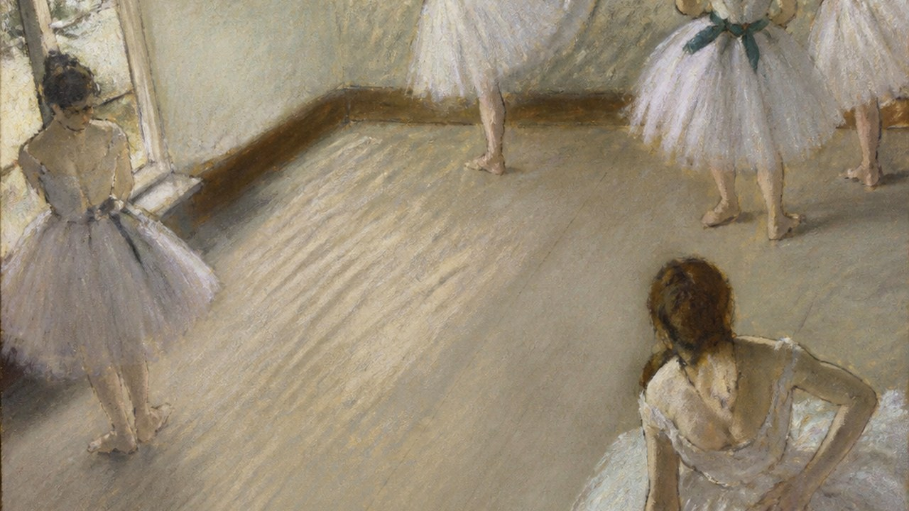

# 埃德加·德加

[English](README.en.md)



> **分类：** 艺术家
> **类型：** 艺术家
> **目录：** `style-packages/artists/edgar-degas`

## 简介

这是一个面向「埃德加·德加」的独立风格包。它把公开作品、研究资料和可观察的媒介、构图、色彩、光线、材质与纹理决策整理为可执行约束，用于生成新的主题，不用于复制某一幅具体作品。

## 策展短评

我会先看“裁切视角、高机位、非对称构图与动作节奏”。它把观看节奏定下来，题材可以按你的需要替换。

## 风格重点

偏置视点、非对称裁切、空间平面与清晰的过渡姿态。舞蹈并非默认题材；Prompt 保留用户给定的人物、动作、场景和数量。

完整规则见 `visual-signature.yaml`、`reproduction.yaml`、`palette/palette.json` 和 `evaluation.yaml`。

## 新架构：偏置观察、空间裁切与过渡姿态（实验）

[`art-direction.yaml`](art-direction.yaml) 使用方向格式 2.1.0，仅在用户声明 `observed-figure-scene` 时启用。只有调用者同时声明 `readable-spatial-plane`，才会应用地面/空间平面规则；方向把观察视点、非对称取景与动作中的身体平衡连成可检查的规则。只有场景适合时才使用高机位或裁切，不默认加入舞者、舞台、镜子或排练室。它与莫里索的手势笔触和开放边缘、阿尔泰米西娅的近距离动作受力构图有明确分工。

```powershell
python tools/compile-style.py style-packages/artists/edgar-degas --direction package --context observed-figure-scene --context readable-spatial-plane --subject "A commuter kneeling to retrieve a dropped glove beside a station bench, seen from a slightly elevated oblique viewpoint" --output runs/style-v2/edgar-degas-job.json
```

此方向仍为实验规则；同题对照和跨主体稳定性待人工评审。局部新旧视觉对照保存在工作区 `runs/edgar-degas-direction-comparison/`，不作为已通过评审的证据。

## 参考来源

- [Edgar Degas / 印象主义](https://commons.wikimedia.org/w/index.php?search=Edgar+Degas&title=Special:MediaSearch&type=image)

## 来源与版权

参考链接只用于研究和视觉分析。外部作品、摄影作品、游戏画面、商标和平台页面仍归原权利人所有；本包不重新分发受版权保护的原作。代表图是新的匿名生成场景，不是相关艺术家、摄影师、设计师或游戏的原作，也不代表合作或授权关系。

详细来源和再分发边界见 [`provenance.yaml`](provenance.yaml)、[`references/manifest.csv`](references/manifest.csv) 和仓库的 [`NOTICE`](../../../NOTICE)。

## 只使用此包

四种方式可以按手边的工具任选其一，不需要同时使用。

### 方式一：交给有生图能力的 Agent

把整个风格包目录上传给具备生图能力的 Agent，或把本地目录路径交给它，并附上下面的任务说明：

```
请使用这个风格包帮助我生成图片。

请先读取本目录中的：
- identity.yaml
- visual-signature.yaml
- reproduction.yaml
- prompts/base.txt
- prompts/negative.txt
- palette/palette.json
- evaluation.yaml

请把这些文件中的规则整合到生成流程中，不要只把风格名称当作 Prompt，也不要复制参考作品。

我的生成需求是：
<填写人物、物体、场景、画幅和用途>

请先把我的需求编译成完整 Prompt，再调用你的生图能力生成图片。生成后，请按照 evaluation.yaml 检查风格特征、构图、颜色、材质、AI 痕迹和 Prompt 遵循度；如果发现明显问题，请说明问题并进行一次针对性修正。
```

### 方式二：直接复制 Prompt

打开 `prompts/base.txt`，将其中的主题、人物、物体、场景和画幅替换为自己的需求；把 `prompts/negative.txt` 中的限制作为负面 Prompt 一并提交到支持文本生图的平台。需要更稳定时，同时参考 `visual-signature.yaml` 和 `palette/palette.json`。

### 方式三：配置 API Key 后提交生成

在你使用的生图平台或自己的编译工具中配置 API Key，将本包的基础 Prompt、负面约束、调色板和必要的参考图一起提交。API Key 只保存在你自己的环境中；本仓库不代管密钥、不托管在线生成服务，也不承诺某个平台的免费额度或接口兼容性。

### 方式四：本地模型 + ComfyUI

将 `prompts/base.txt` 和 `prompts/negative.txt` 接入本地模型或 ComfyUI 工作流；按 `palette/palette.json` 调整颜色，按 `references/manifest.csv` 选择参考图，并用 `reproduction.yaml` 中的参数约束构图、材质和光线。生成后可用 `evaluation.yaml` 做人工或自动复核。

参考图只用于理解可观察特征，不要复制原作的具体构图、人物、文字、商标或标志。模型权重、API Key 和生成图片由使用者自行管理。
