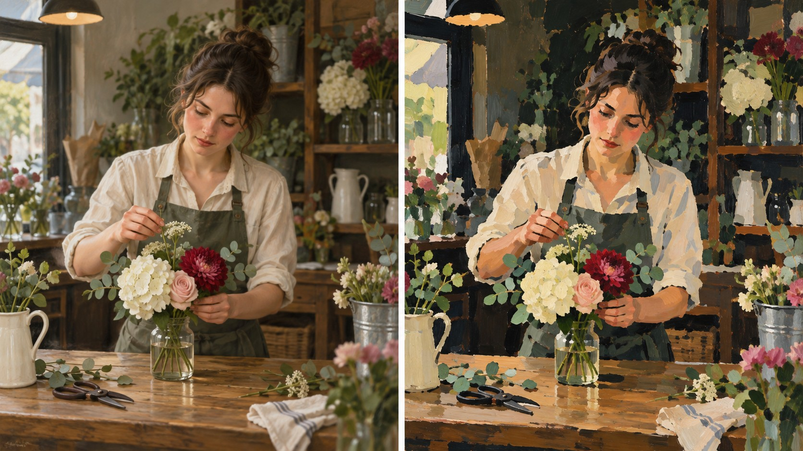

# 新旧架构视觉对照

- **同一输入主题：** `A florist arranging a small display at a neighborhood shop counter`
- **图像形式：** 单张左右拼图（左：旧版包默认规则；右：新版方向规则）。
- **任务记录：** [旧版编译任务](legacy-job.json)、[新版方向编译任务](direction-job.json)。
- **人工复核：** 两图都表现花店店员在柜台整理花束，人物、动作、柜台和花束数量级一致。旧版主要靠柔和明暗和连续写实塑形；新版能看到相邻的平直色块、选择性加重的轮廓，以及更松动的背景笔触。主体仍清楚，未出现咖啡馆、酒吧等默认场景。新版的近景构图压缩与旧版差异不明显，不能据此确认该规则有效；新版的笔触和色面处理可见，但更接近一般化的表现性油画，不能据此证明马奈专属特征已稳定复现。
- **限制：** 两版由独立生图调用完成，没有固定随机种子，不能单独证明差异由架构规则造成，也不能证明规则跨题材稳定。此复核只覆盖一个题材；包状态继续保持 `experimental`，跨题材结果仍待补齐。
