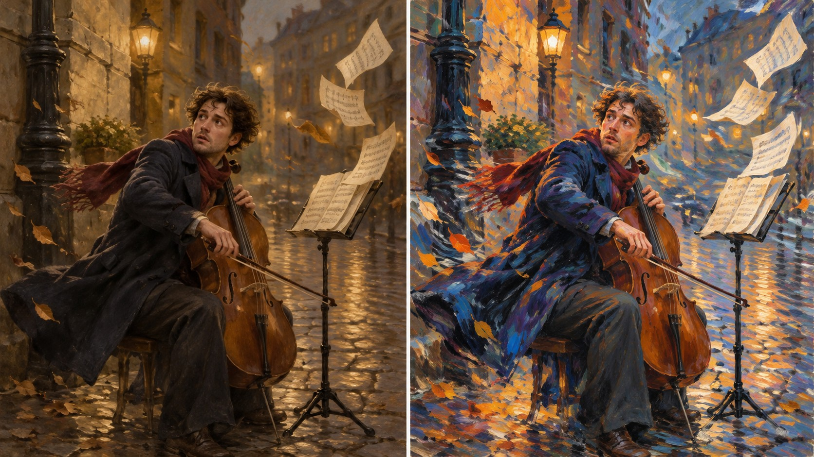

# 新旧架构视觉对照

- **同一输入主题：** `A street musician turning toward a sudden gust as sheet music lifts`
- **图像形式：** 单张左右拼图（左：旧版包默认规则；右：新版方向规则）。
- **任务记录：** [旧版编译任务](legacy-job.json)、[新版方向编译任务](direction-job.json)。
- **人工复核：** 两图均保留街头大提琴演奏者、掀起的乐谱和湿润街道。旧版以连续暖棕明暗塑造环境；新版增加橙红与群青的相邻色块，衣袖、围巾和地面出现更有方向性的短促笔触，风与音乐的动势更强。主体和主要道具仍清楚，未见额外人物。该差异符合色彩对置与动态笔触方向，但单一题材不能证明稳定复现。
- **限制：** 两版由独立生图调用完成，没有固定随机种子，不能单独证明差异由架构规则造成，也不能证明规则跨题材稳定。包状态继续保持 `experimental`，需要更多主题与人工复核。
