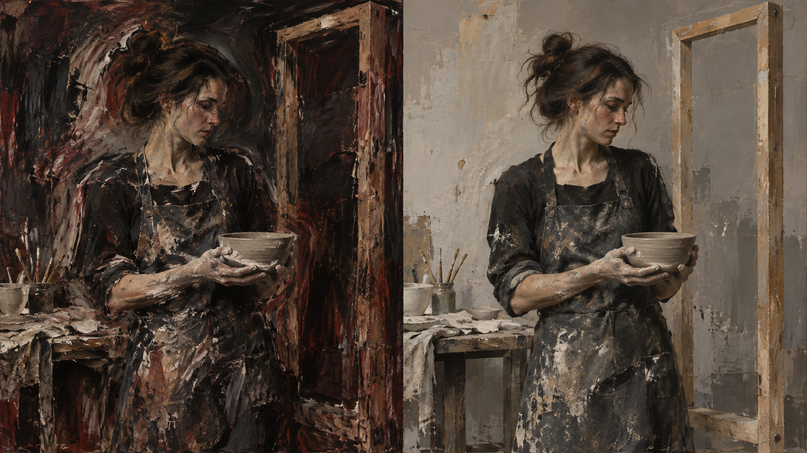

# 培根包新版方向对照（实验）

同一测试主体：`A ceramicist holding a clay bowl beside a tall wooden frame in a quiet studio`。两份提示词由当前仓库编译器分别按旧版默认路径和新版 `enclosed-figurative-tension` 上下文生成，见本目录中的 JSON。

图片是用于讨论方向差异的 AI 示意图，并非由两份编译 JSON 实际渲染得到；左右画面也不是受控实验结果。新版希望把差异收敛到空间框定、局部轮廓偏移和选择性颜料处理，同时维持主体可辨认。视觉审查尚未完成，因此规则保持 `experimental`。
