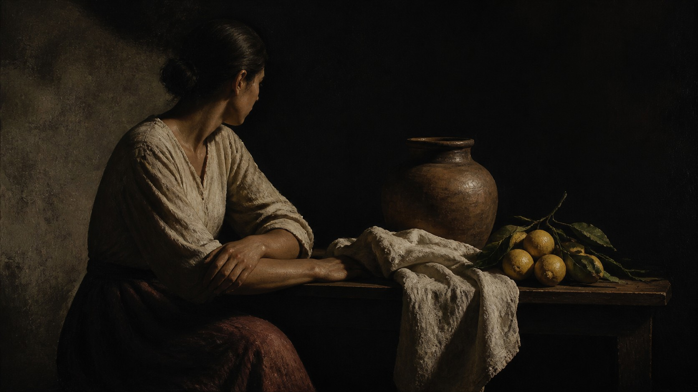

# Francisco de Zurbarán

[中文版](README.md)



> **Category:** artist
> **Domain:** painting
> **Path:** `style-packages/artists/francisco-de-zurbaran`

## Overview

A reference-backed package for Francisco de Zurbarán, built around monastic stillness, sculptural volume, and restrained dark-ground realism.

This is an independently usable style package. It turns observable medium,
composition, lighting, color, surface, texture, and reproduction decisions into
executable guidance for new subjects. It is not intended to reproduce a specific
work.

## Curatorial note

Start with “isolated forms, quiet geometry, sculptural light, and a broad dark field with monastic stillness”. It sets the viewing rhythm while leaving the subject open to your prompt.

## Read before use

- `identity.yaml`: scope, subjects, and exclusions
- `visual-signature.yaml`: features that should survive a subject change
- `reproduction.yaml`: medium, materials, and construction order
- `prompts/base.txt`, `prompts/negative.txt`: prompt constraints
- `palette/palette.json`: color roles and values
- `evaluation.yaml`: post-generation checks
- `references/manifest.csv`, `provenance.yaml`: sources and rights boundaries

## Sources and rights

References are used for research and visual analysis. External artworks,
photographs, game imagery, trademarks, and platform pages remain the property of
their respective rights holders. Generated examples are new anonymous scenes and
are not original works by, or endorsements from, the referenced person, movement,
school, or game.

See [`provenance.yaml`](provenance.yaml),
[`references/manifest.csv`](references/manifest.csv), and the repository
[`NOTICE`](../../../NOTICE) for source and redistribution boundaries.

## New architecture: ordered still life and focused side light (experimental)

[`art-direction.yaml`](art-direction.yaml) uses direction format 2.1.0 and is enabled only when `ordered-object-still-life` is explicitly declared. It organizes negative space around user-specified objects and uses one lateral light to describe volume. Material-specific surface detail activates only when the caller declares `multiple-distinct-materials`. It does not add citrus, roses, vessels, or devotional imagery by default.

This differs from Caravaggio's direction, which uses strong chiaroscuro for close figures and dramatic action, and Bacon's direction, which builds tension through spatial framing and contour shifts. Zurbarán's direction focuses on order among sparse objects, still lateral light, and material distinction.

```powershell
python tools/compile-style.py style-packages/artists/francisco-de-zurbaran --direction package --context ordered-object-still-life --subject "One blue ceramic teapot and a folded linen cloth on a plain wooden table"
```

See [`comparisons/`](comparisons/) for legacy/new compiled prompts and an illustrative image. The direction remains experimental; the image is not a model render from those jobs.

## Use only this package

Choose one of the following methods.

### Method 1: Give the package to an image-capable Agent

Upload this package directory to an Agent, or provide its local path, and ask:

```text
Use this style package to help me generate an image.

First read identity.yaml, visual-signature.yaml, reproduction.yaml,
prompts/base.txt, prompts/negative.txt, palette/palette.json, and evaluation.yaml.
Compile their rules into the generation process. Do not use only the style name
as a prompt and do not copy a reference work.

My image request is:
<subject, objects, scene, aspect ratio, and purpose>

Compile the full prompt first, then generate the image. After generation, check
style features, composition, color, material, AI artifacts, and request adherence
against evaluation.yaml, and report remaining risks.
```

### Method 2: Copy the prompts

Replace the subject, objects, scene, and aspect ratio in `prompts/base.txt` and
send `prompts/negative.txt` as the negative prompt. Use the visual signature and
palette for tighter control.

### Method 3: Submit through your own API tool

Configure your API key in your own image platform or prompt compiler, then submit
the base prompt, negative constraints, palette, and any required reference list.
The repository does not host a generation service or manage API keys.

### Method 4: Local model + ComfyUI

Connect the prompts to a local model or ComfyUI workflow. Use the palette,
reproduction notes, and reference manifest to set color, composition, material,
and lighting. Review the output against `evaluation.yaml`.

Users manage model weights, API keys, and generated images themselves. References
are for observable traits only; do not copy a source work's exact composition,
figures, text, trademark, or logo.


