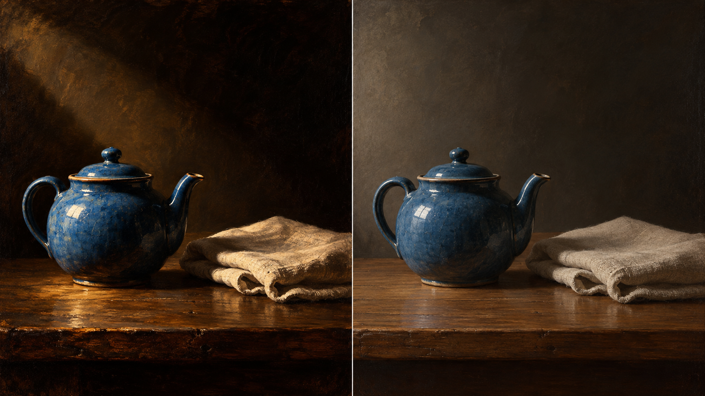

# 苏巴朗包新版方向对照（实验）

同一测试主体：`One blue ceramic teapot and one folded linen cloth on a plain wooden table`。旧版默认路径与新版 `ordered-object-still-life` 编译结果分别记录在两个 JSON 文件中，编译器输入完全相同。

此图是 AI 生成的讨论用示意，不是由上述编译结果实际渲染，也不是受控实验。新版方向把规则重点限定为物件留白、单一侧光和材质区分，不自动加入来源作品中的物件。规则尚未经过人工图像评审，状态保持 `experimental`。
