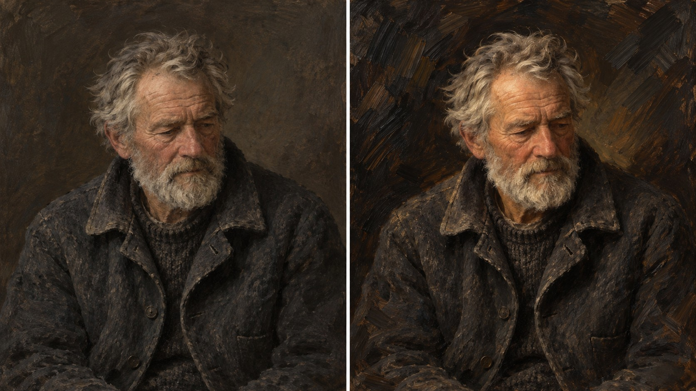

# 新旧架构视觉对照

- **同一输入主题：** `A retired lighthouse keeper in a worn wool jacket, looking down thoughtfully`
- **图像形式：** 单张左右拼图（左：旧版包默认规则；右：新版方向规则）。
- **任务记录：** [旧版编译任务](legacy-job.json)、[新版方向编译任务](direction-job.json)。
- **人工复核：** 两图均为低头沉思的退休灯塔看守人，粗呢外套和深色背景保持一致。新版背景与衣领处的刷痕更粗、更可见，人物光线略暖；但脸部、裁切、暗部比例和整体写实塑形几乎相同。此次对照没有显示明确的架构增量，也没有足够证据确认新版特有的戈雅式表达。应视为未证明差异的样本，不能当作新版效果通过。
- **限制：** 两版由独立生图调用完成，没有固定随机种子，不能单独证明差异由架构规则造成，也不能证明规则跨题材稳定。包状态继续保持 `experimental`，需要更多主题与人工复核。
