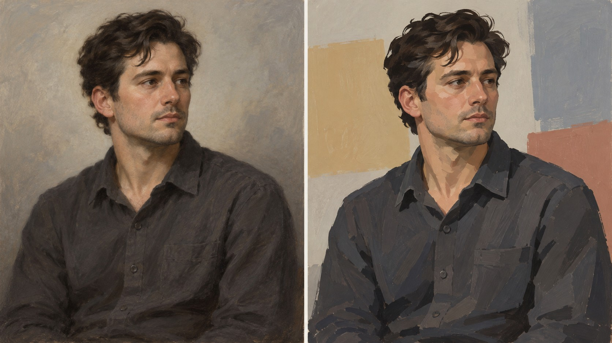

# 新旧架构视觉对照

- **同一输入主题：** `A person in a plain work shirt seated against a pale wall, looking slightly to the side`
- **图像形式：** 单张左右拼图（左：旧版包默认规则；右：新版方向规则）。
- **任务记录：** [旧版编译任务](legacy-job.json)、[新版方向编译任务](direction-job.json)。
- **人工复核：** 两图都保留穿素色工作衬衫的人物半身像和侧向视线。旧版背景柔和、体积过渡连续；新版把背景改成大块米黄、灰蓝和砖红平面，脸部与衣服也出现较硬的色面边界，主体仍清楚。此变化显示平面色面规则可见，但样本没有呈现足以辨认弗里达·卡罗个人语言的象征性安排；题目也没有要求象征物，因此不能据此判定艺术家风格已通过。
- **限制：** 两版由独立生图调用完成，没有固定随机种子，不能单独证明差异由架构规则造成，也不能证明规则跨题材稳定。包状态继续保持 `experimental`，需要更多主题与人工复核。
