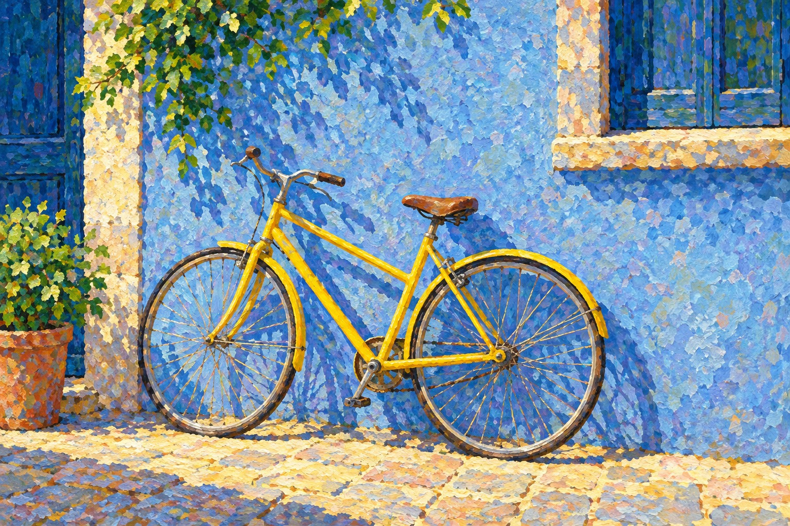

# 新旧架构实际生图对照

| 旧版包默认规则 | 新版方向规则 |
|---|---|
|  |  |

- **同一输入主题：** `One yellow bicycle leaning against a blue plaster wall in clear midday light`
- **任务提示：** 旧版和新版使用[编译任务](legacy-compiled-job.json)、[方向任务](direction-compiled-job.json)中保存的提示词与负面约束。
- **生成记录：** 两图分别使用 OpenAI imagegen 生成；工具未提供可记录的随机种子，未控制随机性。 Added a cardinality lock after the first legacy generation returned a duplicate bicycle.
- **人工复核：** Both images retain one yellow bicycle against a blue wall. The direction sample has slightly more plane-following, separated marks, but the difference is subtle because the legacy package already uses divided color. Treat this as weak evidence of incremental direction behavior; keep experimental.
- **限制：** 这组对照能说明单次输出，不足以证明差异只由架构规则造成或可跨题材稳定。方向继续保持 `experimental`。
