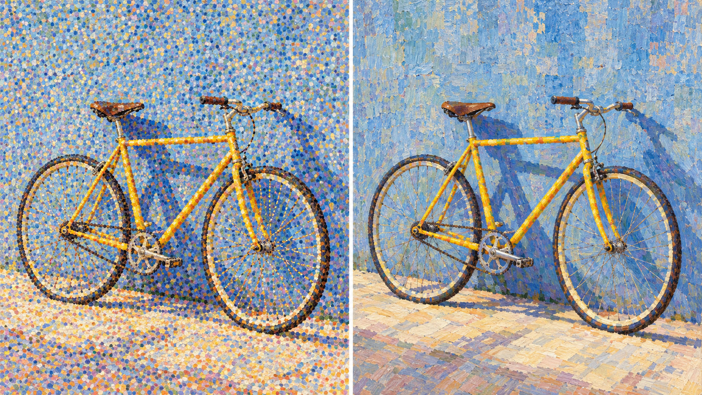

# 修拉包新版方向对照（实验）

同一测试主体：`One yellow bicycle leaning against a blue plaster wall in clear midday light`。两个 JSON 文件分别保存旧版默认路径和新版 `measured-chromatic-composition` 的编译结果，均由仓库编译器生成。

此图是 AI 生成的讨论示意，不是由上述 JSON 提示词实际渲染，也不是受控实验。新版规则尝试把差异落在构图间距、稳定剪影和随平面变化的色笔触上；人工视觉评审尚未完成，因此方向保持 `experimental`。
