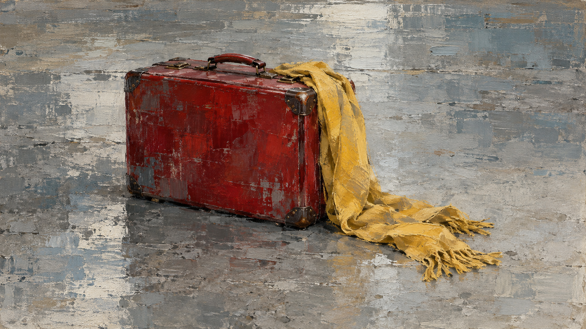
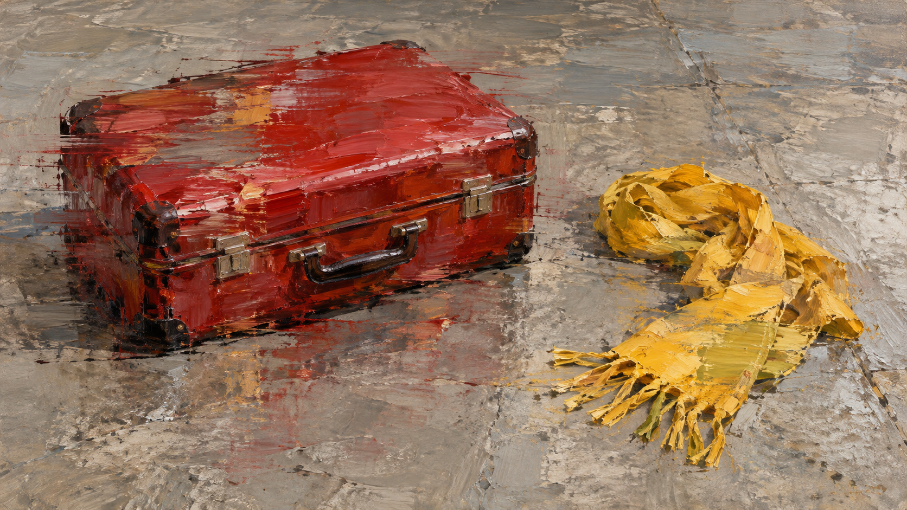

# 里希特包旧版/新版生成对照（实验）

同一测试主体：`One red suitcase and one yellow scarf on a plain concrete floor`。两张图分别由 OpenAI imagegen 根据仓库编译器生成的旧版与新版提示词生成；完整 job 保存在相邻 JSON 文件中。

<table>
<tr><th>旧版默认路径</th><th>新版 layered-image-veil</th></tr>
<tr>
<td></td>
<td></td>
</tr>
</table>

两次生成使用相同主题和画幅，但分别调用生成器，未控制随机种子，因此是可供人工判断方向差异的实际生图样本，不是严格受控实验。新版方向尚未通过人工视觉评审，状态保持 `experimental`。
