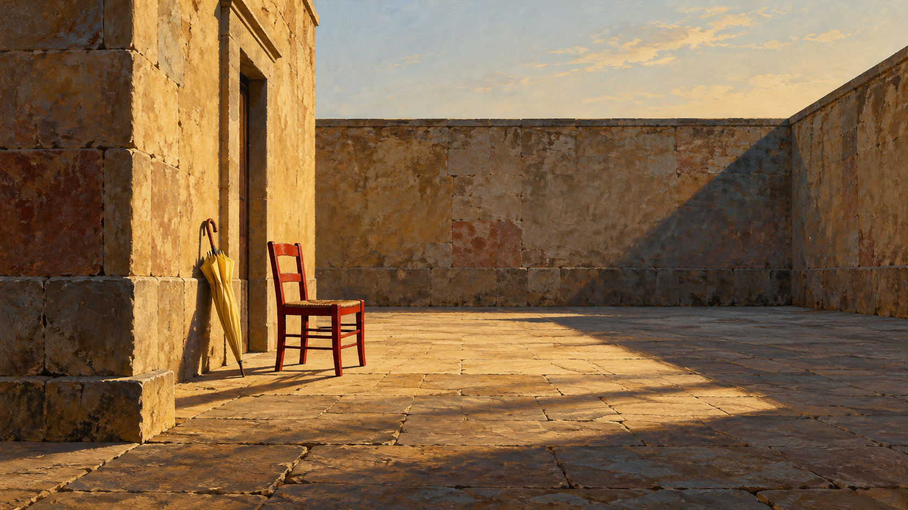
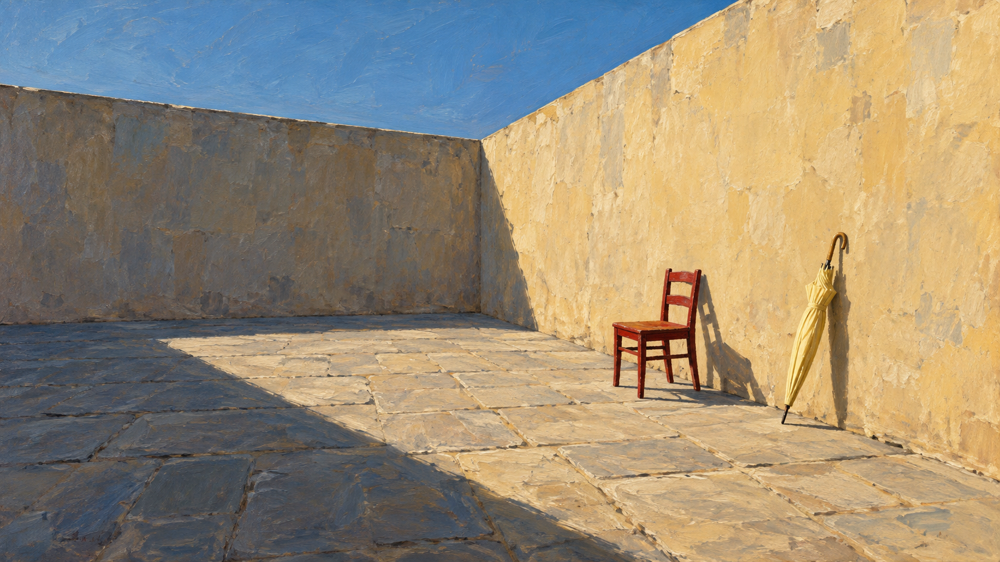

# 德·基里科包旧版/新版生成对照（实验）

相同测试主体：`One red chair and one closed pale-yellow umbrella in an empty stone courtyard`。两张图按仓库编译器各自生成的旧版与新版提示词分别由 OpenAI imagegen 生成；完整编译 job 保存在相邻 JSON 文件中。

<table>
<tr><th>旧版默认路径</th><th>新版 metaphysical-spatial-enigma</th></tr>
<tr>
<td></td>
<td></td>
</tr>
</table>

两次生成使用相同主题和画幅，但分别调用生成器，未控制随机种子，因此可供人工判断规则差异，不构成严格受控实验。新版仍待视觉评审，状态保持 `experimental`。
