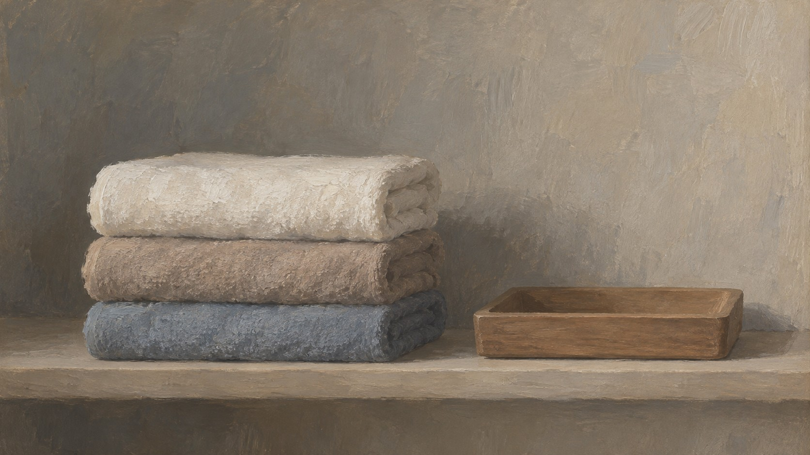
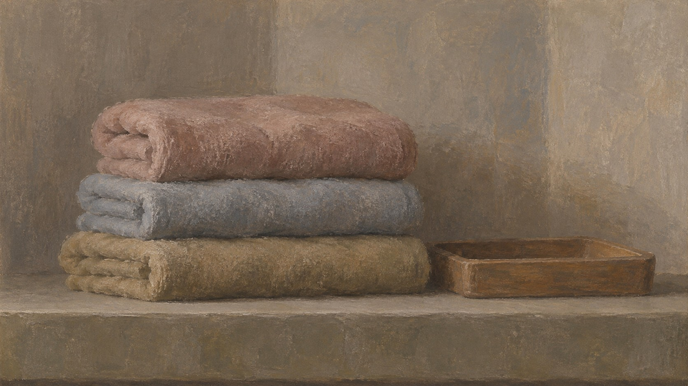

# 新旧架构视觉对照

| 旧版包默认规则 | 新版方向规则 |
|---|---|
|  |  |

- **同一输入主题：** `Three folded towels and a small wooden tray on a shelf`
- **任务记录：** [旧版编译任务](legacy-job.json)、[新版方向编译任务](direction-job.json)。
- **复核结论：** 已人工浏览该样例，确认两版按相同主题生成；仅作单一题材的初步目视检查。
- **限制：** 两版来自独立生图调用，没有固定随机种子，不能单独证明差异由架构规则造成，也不能证明规则跨题材稳定。包状态继续保持 `experimental`。
