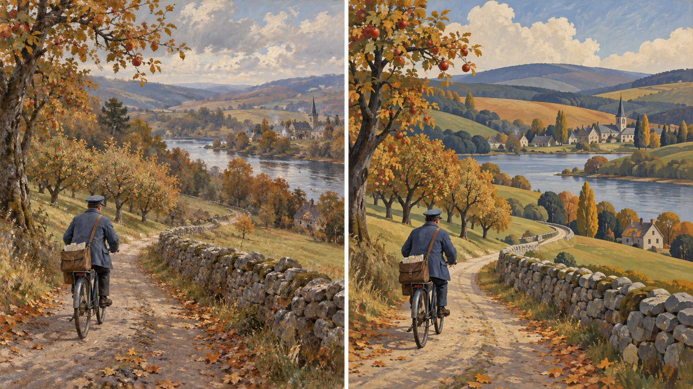

# 新旧架构视觉对照

- **同一输入主题：** `A postal cyclist passing a stone orchard wall in late autumn`
- **图像形式：** 单张左右拼图（左：旧版包默认规则；右：新版方向规则）。
- **任务记录：** [旧版编译任务](legacy-job.json)、[新版方向编译任务](direction-job.json)。
- **人工复核：** 两图都保留秋日乡间骑邮差、自行车、石墙、河谷村庄和教堂尖顶。新版将远山、树冠和田地压成更清楚的弧形色带，边缘更规整；旧版保留较多细碎叶片和连续笔触。人物与路线关系仍可读，未发现新增的叙事情节。乡村区域主义的处理在新版中更明确，但基线已具备相近题材和色彩，单次结果不足以证明稳定或专属风格差异。
- **限制：** 两版由独立生图调用完成，没有固定随机种子，不能单独证明差异由架构规则造成，也不能证明规则跨题材稳定。包状态继续保持 `experimental`，需要更多主题与人工复核。
