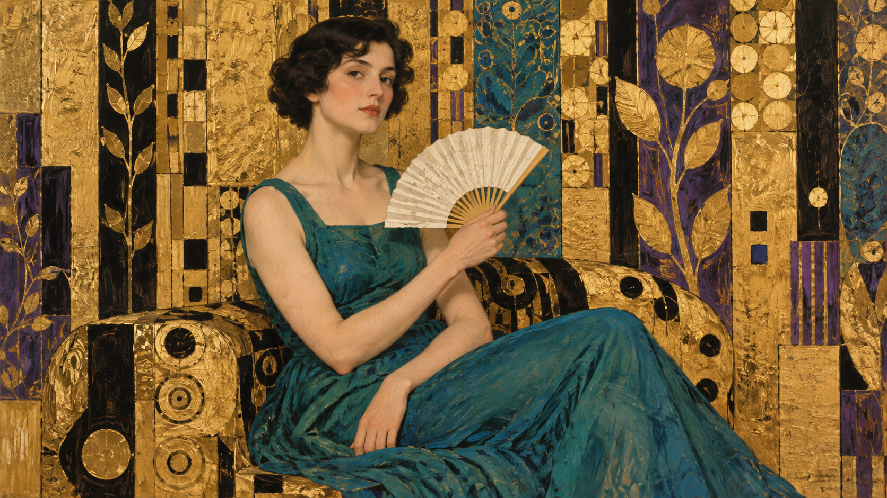

# 克里姆特包旧版/新版生成对照（实验）

同一测试主体：`One seated adult with short dark hair, wearing a plain teal dress and holding one white paper fan`。两张图分别由 OpenAI imagegen 根据仓库编译器生成的旧版与新版提示词生成；完整编译 job 保存在相邻 JSON 文件中。

<table>
<tr><th>旧版默认路径</th><th>新版 modeled-figure-ornamental-field</th></tr>
<tr>
<td></td>
<td></td>
</tr>
</table>

两次生成使用相同主体描述和画幅，但分别调用生成器且未固定随机种子；它们是供人工判断方向差异的实际样本，不是严格受控实验。新版尚未完成视觉评审，状态保持 `experimental`。
