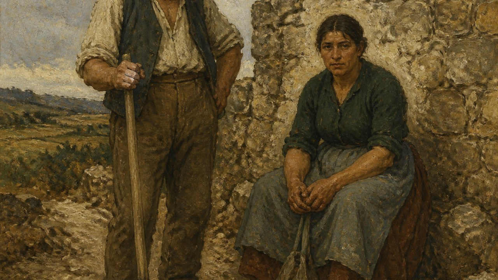

# Gustave Courbet

[中文](README.md)



> **Category:** artists
> **Type:** artist
> **Path:** `style-packages/artists/gustave-courbet`

## Overview

This independent style package for **Gustave Courbet** turns public references and observable decisions about medium, composition, color, light, material, and texture into executable constraints. It is intended for new subjects, not for reproducing a specific artwork.

## Curatorial note

Start with “solid bodies, heavy material presence, earthy colour, and an unidealized ground”. It sets the viewing rhythm while leaving the subject open to your prompt.

## Visual focus

厚重物质感、未理想化人物、土色现实与坚实地面. The prompt emphasizes these observable traits while requiring a new subject, arrangement, and object relationship.

See `visual-signature.yaml`, `reproduction.yaml`, `palette/palette.json`, and `evaluation.yaml` for the complete rule set.

## Reference source

- [Gustave Courbet / 现实主义](https://commons.wikimedia.org/w/index.php?search=Gustave+Courbet&title=Special:MediaSearch&type=image)

## Rights and attribution

Reference links are provided for research and visual analysis only. External artworks, photographs, game images, trademarks, and platform pages remain the property of their respective rights holders. This package does not redistribute protected source works. The representative image is a new anonymous generated scene, not an original work by the named artist, photographer, designer, or game, and does not imply endorsement or authorization.

See [`provenance.yaml`](provenance.yaml), [`references/manifest.csv`](references/manifest.csv), and the repository [`NOTICE`](../../../NOTICE) for boundaries.

## New architecture: tactile paint and grounded weight (experimental)

[`art-direction.yaml`](art-direction.yaml) uses direction format 2.1.0 and is enabled only when `tactile-material-realism` is explicitly declared. Direct, unidealized form is a base rule; declare `tactile-surfaces-benefit-from-visible-paint-relief` and `subjects-rest-in-physical-environment` only when applicable to activate impasto or grounded-weight rules.

This differs from Van Gogh's directional strokes, which express movement and emotion; Courbet's heavy marks describe the physical material. It does not add workers, poverty narratives, or rustic props by default.

```powershell
python tools/compile-style.py style-packages/artists/gustave-courbet --direction package --context tactile-material-realism --subject "One chipped blue enamel washbasin resting on compact soil beside a rough limestone block"
```

[`comparisons/`](comparisons/) contains the legacy/new compiled jobs and actual generated images of the same subject. The direction remains experimental pending visual review.

## Use only this package

Choose any one of the four methods below. They are alternatives, not steps that must all be completed.

### Method 1: Give the package to an image-capable Agent

Upload the entire style-package directory to an Agent that can generate images, or provide its local path, together with the following instruction:

```
Use this style package to help me generate an image.

First read:
- identity.yaml
- visual-signature.yaml
- reproduction.yaml
- prompts/base.txt
- prompts/negative.txt
- palette/palette.json
- evaluation.yaml

Integrate the rules from these files into the generation process. Do not treat the style name as the whole Prompt, and do not copy a reference work.

My generation request is:
<describe the subject, people, objects, scene, aspect ratio, and intended use>

First compile my request into a complete Prompt, then use your image-generation capability. After generating, check the result against evaluation.yaml for style characteristics, composition, color, material, AI artifacts, and Prompt adherence. If there are clear problems, explain them and make one targeted correction.
```

### Method 2: Copy the Prompt directly

Open `prompts/base.txt` and replace its subject, people, objects, scene, and aspect ratio with your own request. Submit the constraints in `prompts/negative.txt` as the negative Prompt on an image platform that supports text-to-image generation. For more consistent results, also consult `visual-signature.yaml` and `palette/palette.json`.

### Method 3: Configure your API key and submit a job

Configure your API key in the image platform or in your own Prompt compiler, then submit the base Prompt, negative constraints, palette, and any necessary references together. Keep the API key in your own environment. This repository does not store keys, host an online generation service, or promise free quota or compatibility with any particular provider.

### Method 4: Local model + ComfyUI

Connect `prompts/base.txt` and `prompts/negative.txt` to a local model or ComfyUI workflow. Use `palette/palette.json` for color targets, `references/manifest.csv` to choose references, and `reproduction.yaml` to constrain composition, materials, and lighting. Use `evaluation.yaml` for manual or automated review after generation.

Use references to understand observable characteristics. Do not copy a source work's exact composition, people, text, trademarks, or marks. Model weights, API keys, and generated images remain under your control.
