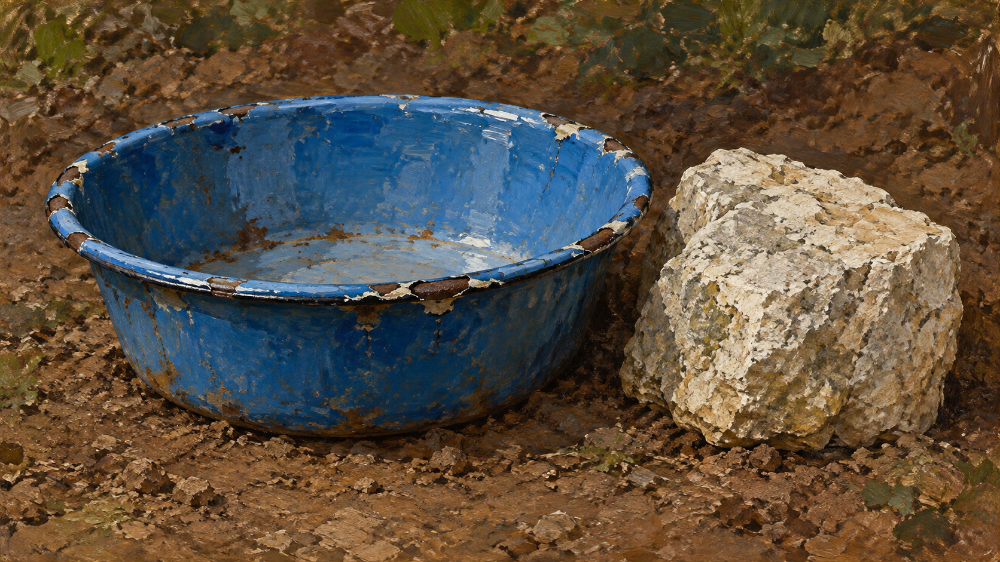
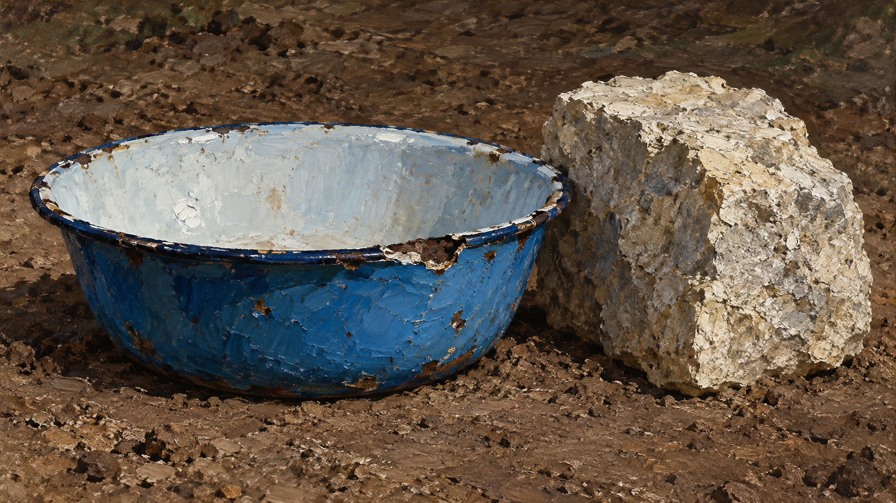

# Courbet direction comparison

Both samples use the same subject brief: **one chipped blue enamel washbasin resting on compact soil beside one rough limestone block**. Each image is a separate generation using the legacy package prompt or the compiled `tactile-material-realism` art direction. The prompt jobs are preserved beside the images.

<table>
<tr><th>Legacy package prompt</th><th>New art direction: tactile material realism</th></tr>
<tr><td></td><td></td></tr>
<tr><td>Legacy default emphasizes earthy color and blunt visible brushwork; texture spreads broadly across the soil and basin.</td><td>The new direction asks for selected impasto tied to material, a quieter ground, and clear contact weight. The generated sample shows more distinct relief on the chipped enamel rim and limestone.</td></tr>
</table>

## Reading this comparison

- The subject, item counts, and landscape framing were held constant.
- These are separate image-generation calls without a fixed random seed, so this is an inspectable sample pair, not a controlled benchmark. Composition and local details may vary between calls.
- Human visual review is still pending. The new direction remains **experimental** and is not enabled by default.
- The new direction should be assessed on additional subjects before changing that status.

## Files

- `legacy-job.json`: compiled legacy prompt job.
- `direction-job.json`: compiled art-direction prompt job.
- `legacy-render.png` and `direction-render.png`: generated samples shown above.
