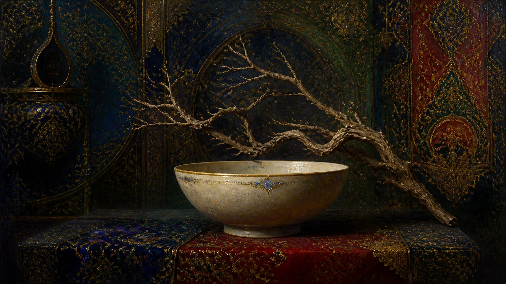

# Gustave Moreau

[中文版](README.md)



> **Category:** Artist  · **Domain:** painting
> **Path:** style-packages/artists/gustave-moreau

## Overview

Use symbolic line, jewel-like color, decorative detail, and dreamlike space while leaving room for interpretation.

## Notes

Moreau used line, arabesque curves, and color to evoke ideas, balancing precise detail against mysterious space. This package extracts those decisions about line, color, ornament, and symbolism without automatically adding mythological figures, religious scenes, or a particular story.

## Visual signature

- Fine directional lines and decorative curves
- Dense color layers of jewel blue, deep red, gold, and dark green
- Flat detail layered with dreamlike space
- Precise local detail within an overall surface that remains mysterious

## Subject independence

This package controls visual treatment, not the user's subject, object count, location, or story. The representative image is an anonymous demonstration. It does not add a recurring landmark, character, prop, or narrative event.

## Sources and rights

Research sources are linked for study and attribution. External works, photographs, game materials, trademarks, and platform pages remain with their respective rights holders. The generated demonstration is original and anonymous, not a source artwork or endorsement.

- [Gustave Moreau museum overview](https://musee-moreau.fr/en/art-gustave-moreau)

See [provenance.yaml](provenance.yaml), [references/manifest.csv](references/manifest.csv), and the repository [NOTICE](../../../NOTICE).

## New architecture: symbolic line, jewel-like color, and mystery (experimental)

[`art-direction.yaml`](art-direction.yaml) applies only when `symbolic-line-color-enigma` is explicitly declared. It translates Moreau's direction into precise arabesque curves, jewel-like color planes, deliberate tension between contour and color, and selective fine detail. The image may retain mystery while the requested subject, count, and setting remain clear.

Unlike Klimt's contrast between modeled figures and patterned regions, this direction builds an imaginative enigma through line, colored planes, and local detail; it does not require a figure or gold leaf. It adds no mythological, biblical, or religious figures, objects, symbols, or events by default.

```powershell
python tools/compile-style.py style-packages/artists/gustave-moreau --direction package --context symbolic-line-color-enigma --subject "One white ceramic cup on a plain tabletop"
```

[`comparisons/`](comparisons/) holds the compiled legacy and new-direction jobs, generation prompts, and sample images. Visual review is pending, so this direction remains experimental.

## Use only this package

Choose one of the following methods based on the tools you have available.

### Method 1: Give the package to an image-capable Agent

Upload this package directory to an Agent, or provide its local path, and ask:

~~~
Use this style package to help me generate an image.
First read identity.yaml, visual-signature.yaml, reproduction.yaml, prompts/base.txt,
prompts/negative.txt, palette/palette.json, and evaluation.yaml.
Integrate the package rules into the workflow; do not rely on the style name alone or copy a reference work.
My image request is:<subject, objects, scene, aspect ratio, and purpose>
Compile the full prompt first, then generate the image. After generation, check style features,
composition, color, material, AI artifacts, and request adherence against evaluation.yaml, and report remaining risks.
~~~

### Method 2: Copy the Prompt

Open [prompts/base.txt](prompts/base.txt), replace the subject, people, objects, scene, and aspect ratio, then submit [prompts/negative.txt](prompts/negative.txt) as a negative prompt to a text-to-image platform.

### Method 3: Generate through your own API

Configure your API key in your own image platform or prompt compiler, then submit the base prompt, negative constraints, palette, and any required references. This repository does not manage keys or host an image-generation service.

### Method 4: Local model + ComfyUI

Connect the prompts to a local model or ComfyUI workflow. Use the palette, reproduction notes, and reference manifest to guide color, composition, material, and lighting. Review the result against [evaluation.yaml](evaluation.yaml).

Users manage model weights, API keys, and generated images themselves. References are for observable traits only; do not copy a source work’s composition, figures, text, trademarks, or logos.
