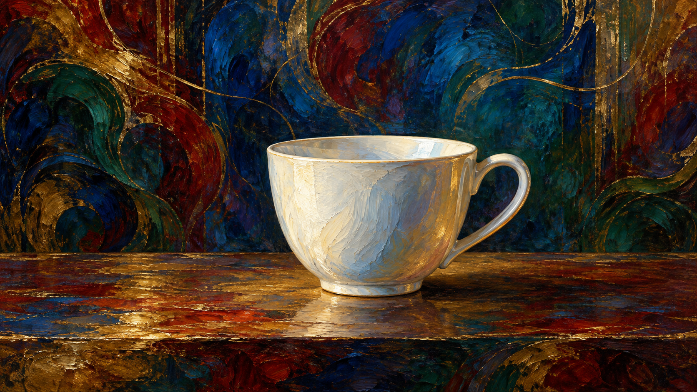
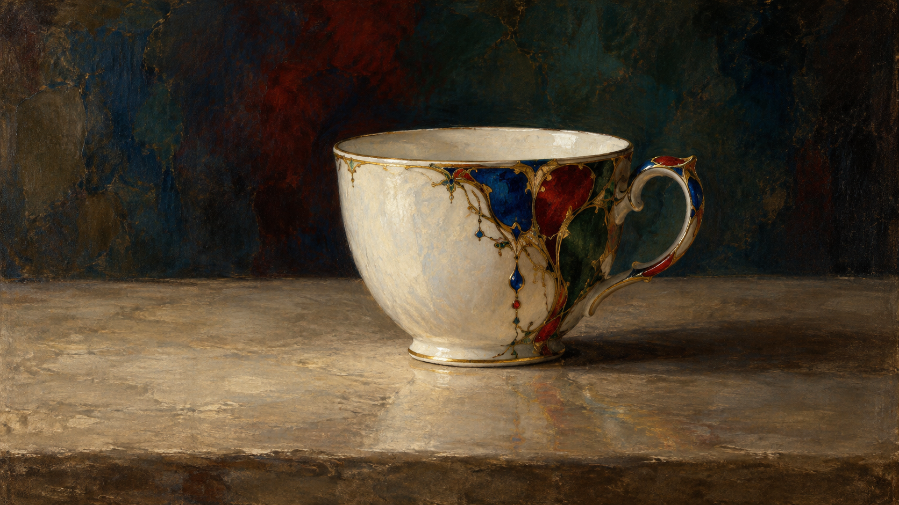

# Moreau direction comparison

Both samples use the same brief: **one white ceramic cup on a plain tabletop**. Each is a separate generation based on the legacy package or the compiled `symbolic-line-color-enigma` direction.

<table>
<tr><th>Legacy package</th><th>New art direction: symbolic line and color</th></tr>
<tr><td></td><td></td></tr>
<tr><td>The legacy signature encourages jewel colors, decorative curves, and a mysterious overall surface, which can spread broadly across the backdrop.</td><td>The new direction keeps the cup count and setting explicit, with decoration concentrated on the cup and less competing detail on the tabletop.</td></tr>
</table>

## Reading this comparison

- The subject and object count were held constant; images were generated in separate calls without a fixed random seed. This is an inspectable sample pair, not a controlled benchmark.
- The exact image-generation prompts are recorded in [`generation-prompts.md`](generation-prompts.md); compiled prompt jobs are preserved as JSON beside the images.
- Human visual review is pending. The new direction remains **experimental** and is not enabled by default.
- Evaluate the rules on more than one subject before changing their status.
