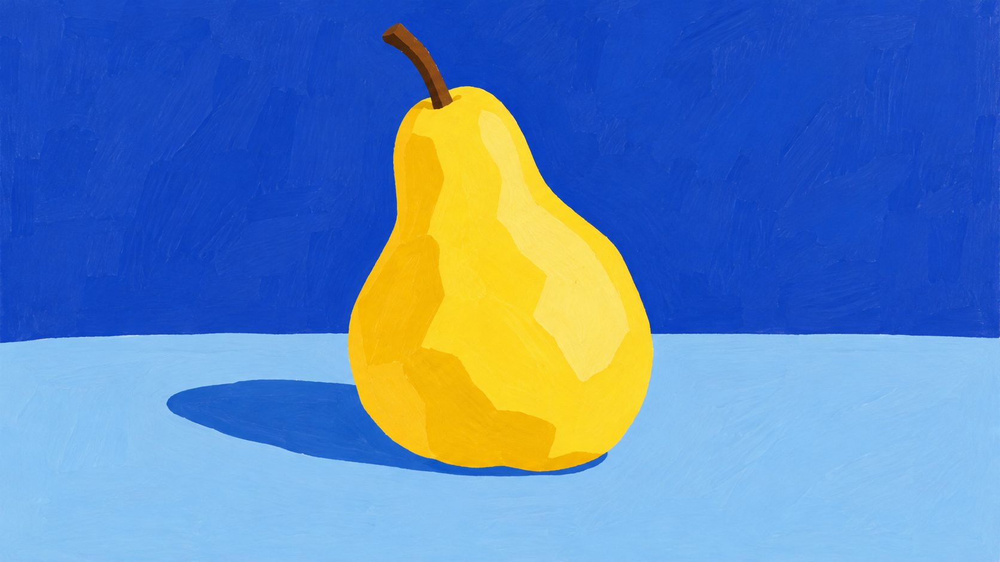
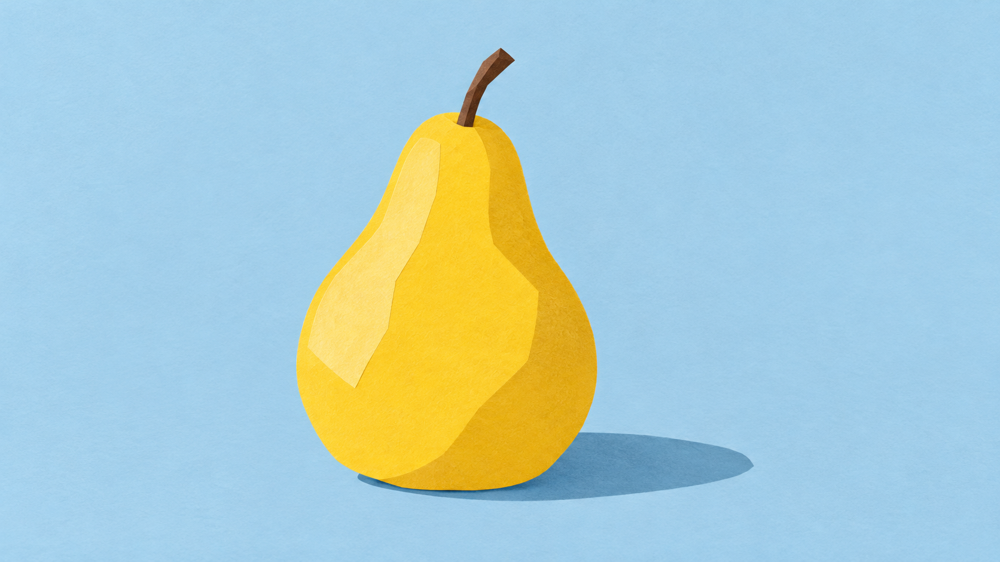

# Matisse direction comparison

Both samples use the same brief: **one yellow pear on a plain pale-blue tabletop**. Each is a separate generation based on the legacy package or the compiled `cut-paper-color-construction` direction.

<table>
<tr><th>Legacy package</th><th>New art direction: cut-paper color construction</th></tr>
<tr><td></td><td></td></tr>
<tr><td>Broad flat-color cues produce a simplified pear with a broad blue setting.</td><td>The direction uses a more explicit cut-shape construction, with distinct flat pieces and deliberate intervals while keeping the subject and setting simple.</td></tr>
</table>

## Reading this comparison

- Subject, count, and setting were held constant. These are separate image-generation calls without a fixed random seed, so this is an inspectable sample pair, not a controlled benchmark.
- The exact image-generation prompts are recorded in [`generation-prompts.md`](generation-prompts.md); the compiled prompt jobs are preserved as JSON.
- Human visual review is pending. The new direction remains **experimental** and is not enabled by default.
- Check the treatment on different kinds of subjects before changing that status.
