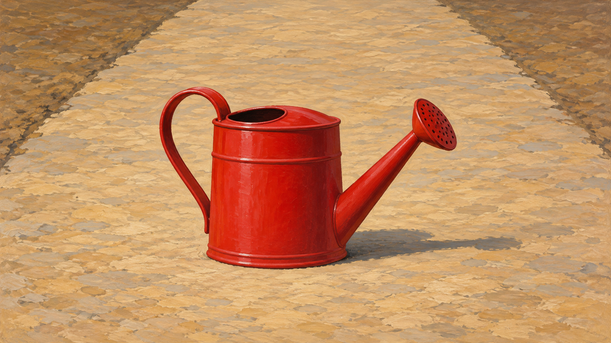
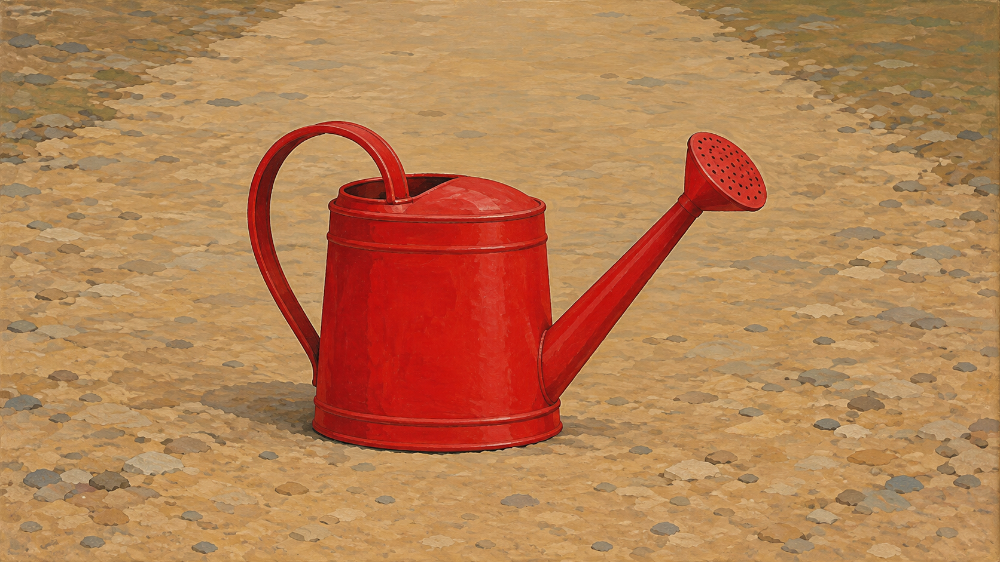

# Rousseau direction comparison

Both images use the same brief: **one red watering can on an empty garden path**. They were generated in separate calls using the legacy package treatment and the compiled `flat-space-natural-detail` direction.

<table>
<tr><th>Legacy package</th><th>New art direction: flat space and crisp natural detail</th></tr>
<tr><td></td><td></td></tr>
<tr><td>Strong subject modeling and visible path texture remain prominent under the broad package prompt.</td><td>Contours and shallow plane relationships are called out more directly, though the sample still has surface texture and reads close to the legacy output.</td></tr>
</table>

## Reading this comparison

- Subject count and setting are held constant. These are separate image-generation calls without a fixed random seed, so the pair is illustrative rather than a controlled benchmark.
- The exact generation prompts are recorded in [`generation-prompts.md`](generation-prompts.md), with both compiled prompt jobs preserved as JSON.
- The stylistic difference in this pair is modest; that is useful evidence for review. The new direction remains **experimental** and is not enabled by default.
- Test a more layered setting and other subjects before revising the rules or status.
