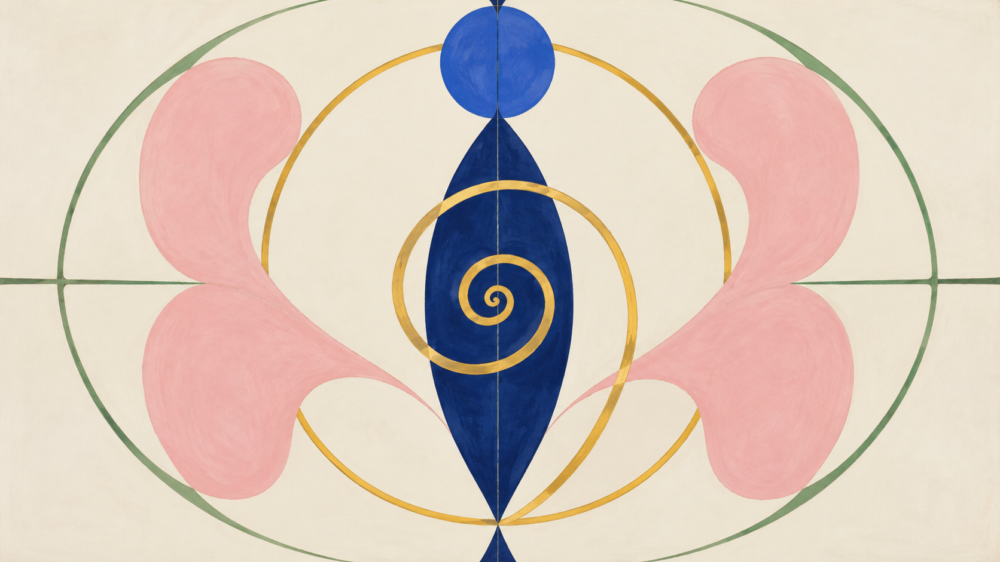
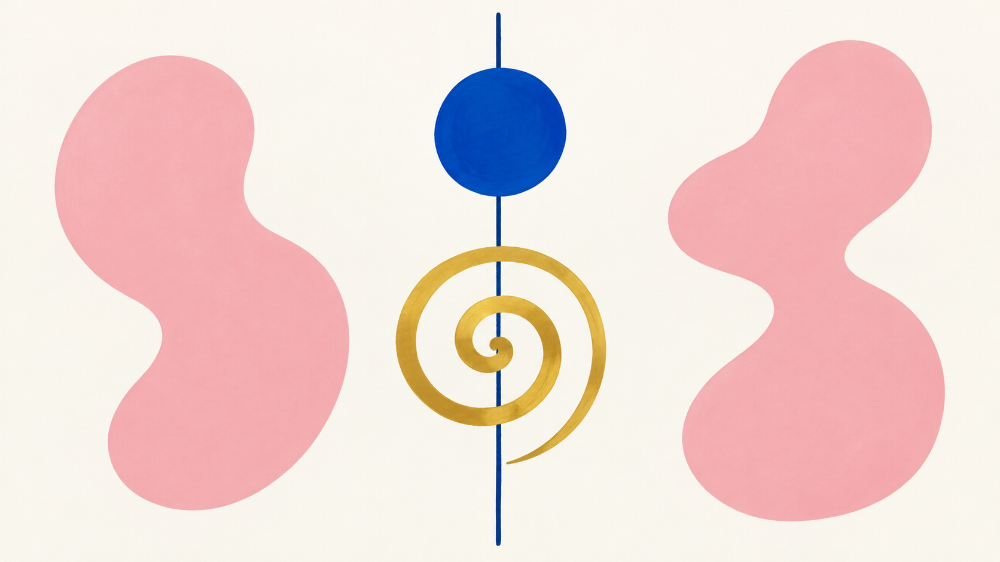

# Hilma af Klint direction comparison

Both generations use the same abstract brief: **one central indigo axis, one gold spiral, two pale-pink biomorphic forms, and one cobalt-blue circle on a warm-white ground**.

<table>
<tr><th>Legacy package</th><th>New art direction: axial spiral and biomorphic order</th></tr>
<tr><td></td><td></td></tr>
<tr><td>The broad legacy language encourages symmetry, circles, spirals, and symbol groups; this sample added several outer rings beyond the requested forms.</td><td>The direction makes the axis and shape contrast clearer, with the circle, central spiral, and two biomorphic forms more separately readable.</td></tr>
</table>

## Reading this comparison

- The same abstract elements and palette were requested in two separate image-generation calls. There was no fixed random seed, so this is an inspectable sample pair, not a controlled benchmark.
- The legacy sample exceeded the requested number of ring-like elements. This is recorded as a subject-count adherence issue, not evidence that the legacy renderer always behaves this way.
- The exact generation prompts are in [`generation-prompts.md`](generation-prompts.md); compiled jobs are preserved as JSON.
- Human visual review is pending. The direction remains **experimental** and is not enabled by default.
