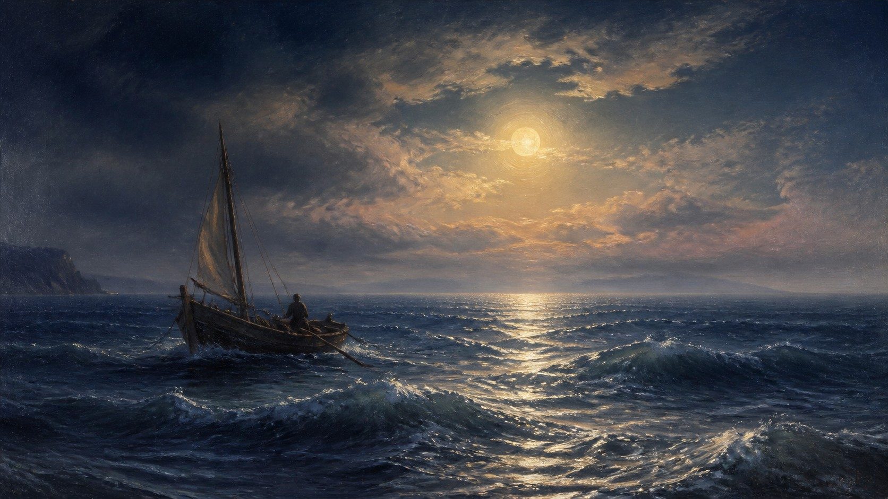

# Ivan Aivazovsky

[中文版](README.md)



> **Category:** artist
> **Domain:** painting
> **Path:** `style-packages/artists/ivan-aivazovsky`

## Overview

Romantic seascape painting built from water motion, atmospheric distance, vessels, and a dominant moonlight or sunset source at monumental scale.

This is an independently usable style package. It turns observable medium,
composition, lighting, color, surface, texture, and reproduction decisions into
executable guidance for new subjects. It is not intended to reproduce a specific
work.

## Curatorial note

“a wide horizon, luminous water, atmospheric distance, and one large light source carrying the scale” is the useful entry point: it arranges the image’s breathing room before the subject arrives.

## Read before use

- `identity.yaml`: scope, subjects, and exclusions
- `visual-signature.yaml`: features that should survive a subject change
- `reproduction.yaml`: medium, materials, and construction order
- `prompts/base.txt`, `prompts/negative.txt`: prompt constraints
- `palette/palette.json`: color roles and values
- `evaluation.yaml`: post-generation checks
- `references/manifest.csv`, `provenance.yaml`: sources and rights boundaries

## New architecture: radiant sea light and wave direction (experimental)

[`art-direction.yaml`](art-direction.yaml) uses direction format 2.1.0 and activates only when the user requests a marine scene and explicitly declares `radiant-sea-light-path`. The reflection-path rule applies only with `visible-light-source`, while `visible-horizon` controls the sea-sky separation rule. Wave marks still follow the requested water movement. It does not prescribe a ship, person, storm, moon, or sunset; the user's requested weather, time, light source, and object count take precedence.

This differs from Turner's weather-motion direction: its focus is the local relationship between water reflections and wave marks, rather than atmospheric color and a motion vector organizing the whole image. It also differs from Courbet's emphasis on material weight and grounded mass; this direction focuses on layered color, wave reflections, and the shared air between sea and sky.

```powershell
python tools/compile-style.py style-packages/artists/ivan-aivazovsky --direction package --context radiant-sea-light-path --context visible-light-source --context visible-horizon --subject "One small red wooden skiff on a calm blue sea beneath a pale-gold opening in gray clouds"
```

[`comparisons/`](comparisons/) contains same-subject legacy and direction jobs, generated images, prompts, and review notes. The sample shows a more broken reflection and clearer foreground wave marks in the direction result, though the overall difference is modest. The images came from separate calls without a fixed random seed, so this is illustrative rather than a controlled experiment. The direction remains experimental pending visual review.

## Sources and rights

References are used for research and visual analysis. External artworks,
photographs, game imagery, trademarks, and platform pages remain the property of
their respective rights holders. Generated examples are new anonymous scenes and
are not original works by, or endorsements from, the referenced person, movement,
school, or game.

See [`provenance.yaml`](provenance.yaml),
[`references/manifest.csv`](references/manifest.csv), and the repository
[`NOTICE`](../../../NOTICE) for source and redistribution boundaries.

## Use only this package

Choose one of the following methods.

### Method 1: Give the package to an image-capable Agent

Upload this package directory to an Agent, or provide its local path, and ask:

```text
Use this style package to help me generate an image.

First read identity.yaml, visual-signature.yaml, reproduction.yaml,
prompts/base.txt, prompts/negative.txt, palette/palette.json, and evaluation.yaml.
Compile their rules into the generation process. Do not use only the style name
as a prompt and do not copy a reference work.

My image request is:
<subject, objects, scene, aspect ratio, and purpose>

Compile the full prompt first, then generate the image. After generation, check
style features, composition, color, material, AI artifacts, and request adherence
against evaluation.yaml, and report remaining risks.
```

### Method 2: Copy the prompts

Replace the subject, objects, scene, and aspect ratio in `prompts/base.txt` and
send `prompts/negative.txt` as the negative prompt. Use the visual signature and
palette for tighter control.

### Method 3: Submit through your own API tool

Configure your API key in your own image platform or prompt compiler, then submit
the base prompt, negative constraints, palette, and any required reference list.
The repository does not host a generation service or manage API keys.

### Method 4: Local model + ComfyUI

Connect the prompts to a local model or ComfyUI workflow. Use the palette,
reproduction notes, and reference manifest to set color, composition, material,
and lighting. Review the output against `evaluation.yaml`.

Users manage model weights, API keys, and generated images themselves. References
are for observable traits only; do not copy a source work's exact composition,
figures, text, trademark, or logo.
