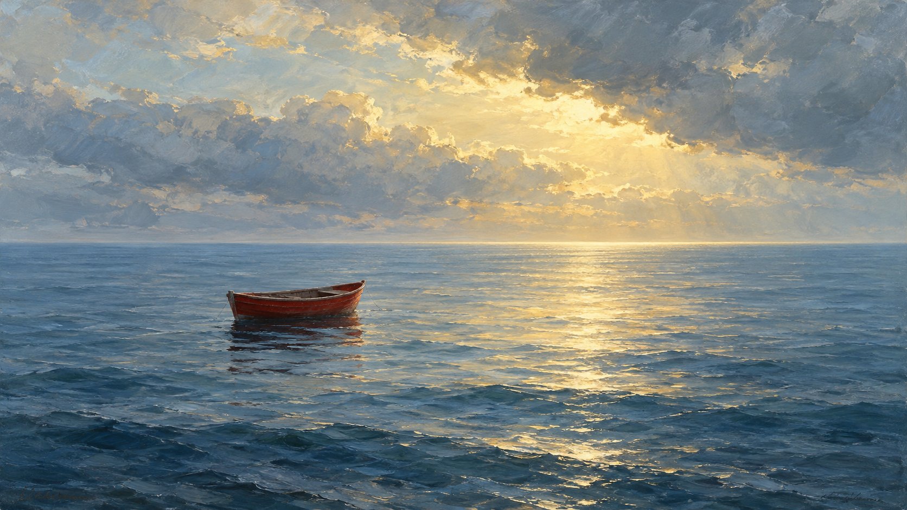
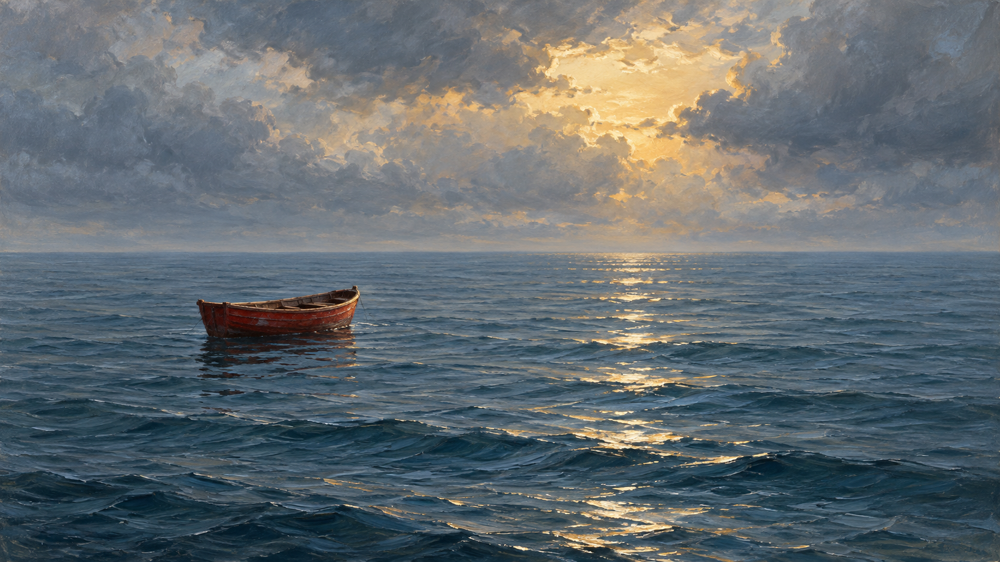

# Ivan Aivazovsky direction comparison

Both images depict the same requested inventory: one small red wooden skiff, calm blue sea, and a pale-gold opening in gray clouds. No people, additional boats, shore, or narrative event were requested.

| Legacy package | `radiant-sea-light-path` direction |
| --- | --- |
|  |  |

The legacy job applies the package's existing broad seascape rules. The direction job explicitly adds a broken reflected-light path, wave marks that vary with distance, and atmospheric separation. In these generated samples, the right image shows a narrower, more segmented reflection and more articulated near-water strokes; the overall difference is modest. The direction is experimental and still needs human review.

These are separate image-generation calls with no fixed random seed or shared latent state. They are an illustrative comparison, not a controlled experiment. The exact generation prompts are in [`generation-prompts.md`](generation-prompts.md); provider-neutral compiled jobs are [`legacy-job.json`](legacy-job.json) and [`direction-job.json`](direction-job.json).
