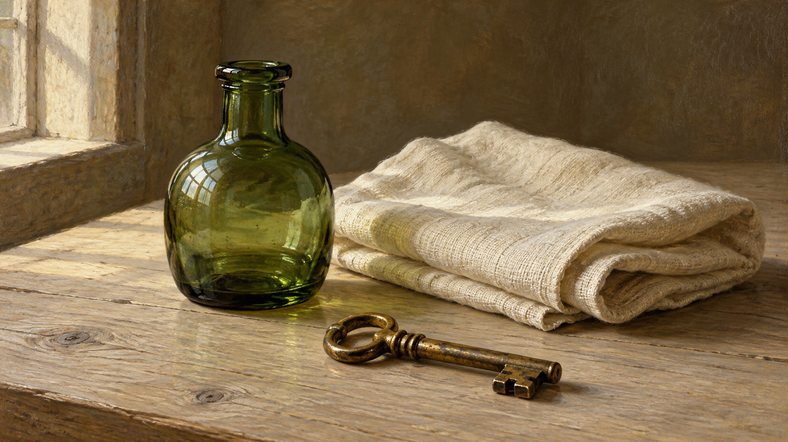
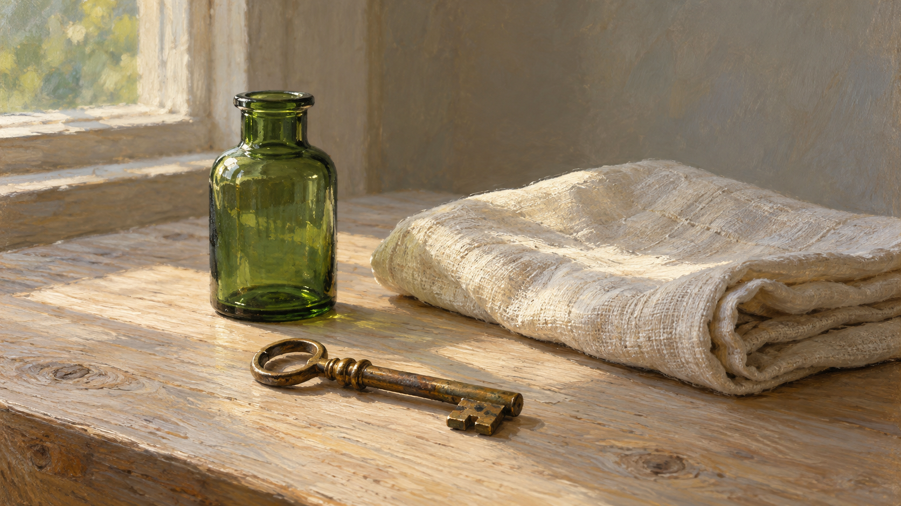

# Jan van Eyck direction comparison

Both images use the same requested still life: one green glass bottle, one folded cream linen cloth, and one tarnished brass key on a pale wooden tabletop near a window.

| Legacy package | `glazed-material-observation` direction |
| --- | --- |
|  |  |

The direction result uses a narrower, more controlled highlight on the glass and brass, with broader light transitions on the cloth and wood. Fine detail is more selective in the direction sample. The difference is visible but still modest; these images do not establish that every generator will produce the same change.

Both images came from separate calls with no fixed seed or shared latent state. This is an illustrative comparison, not a controlled experiment. Exact prompts: [`generation-prompts.md`](generation-prompts.md). Compiled jobs: [`legacy-job.json`](legacy-job.json) and [`direction-job.json`](direction-job.json).
