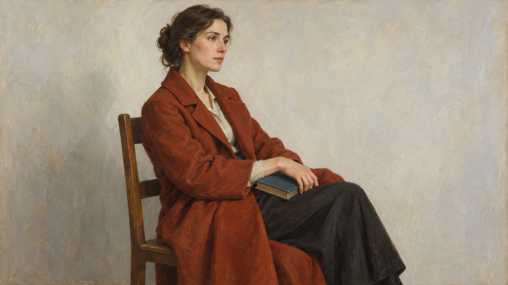
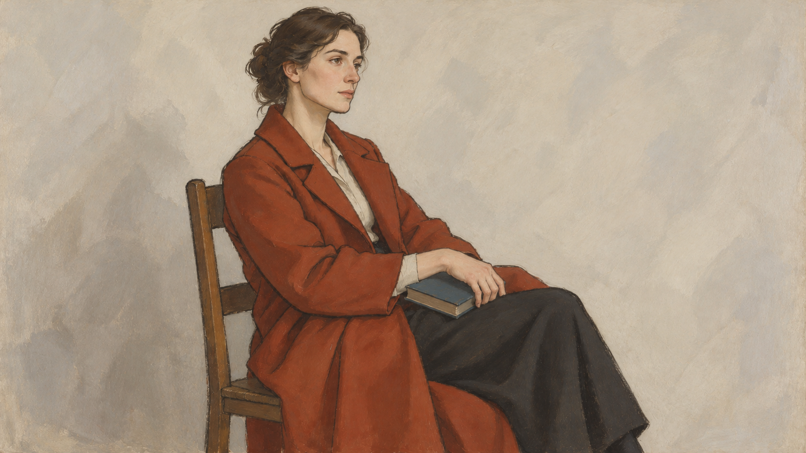

# Ingres direction comparison

Both images show the same adult seated sideways on a wooden chair, wearing a rust-red coat, resting one hand on a closed blue book, against a pale wall.

| Legacy package | `contour-led-figure-study` direction |
| --- | --- |
|  |  |

The direction result uses a clearer continuous contour around the coat and chair, with broad quieter value areas and a less detailed wall. It was generated by editing the legacy image with that image as a composition reference, which keeps the pose and object placement closely aligned. It is still a generated example rather than a guarantee for every model.

Compiled jobs are [`legacy-job.json`](legacy-job.json) and [`direction-job.json`](direction-job.json). Exact image-generation prompts and the reference-edit method are recorded in [`generation-prompts.md`](generation-prompts.md). Both files are 1672 × 941 pixels (approximately 16:9).
