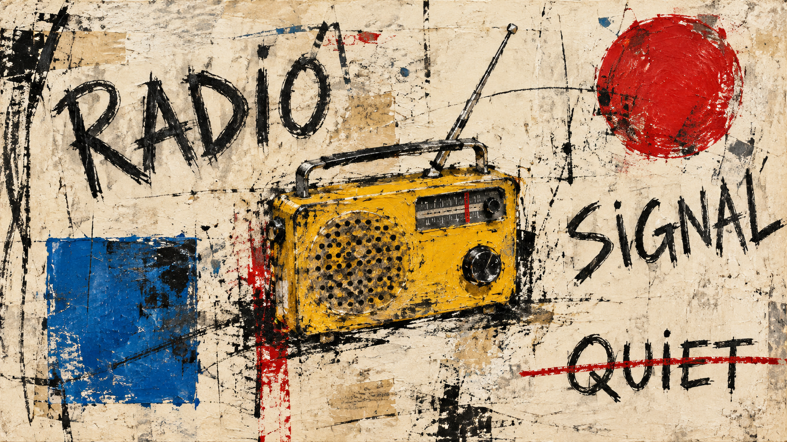
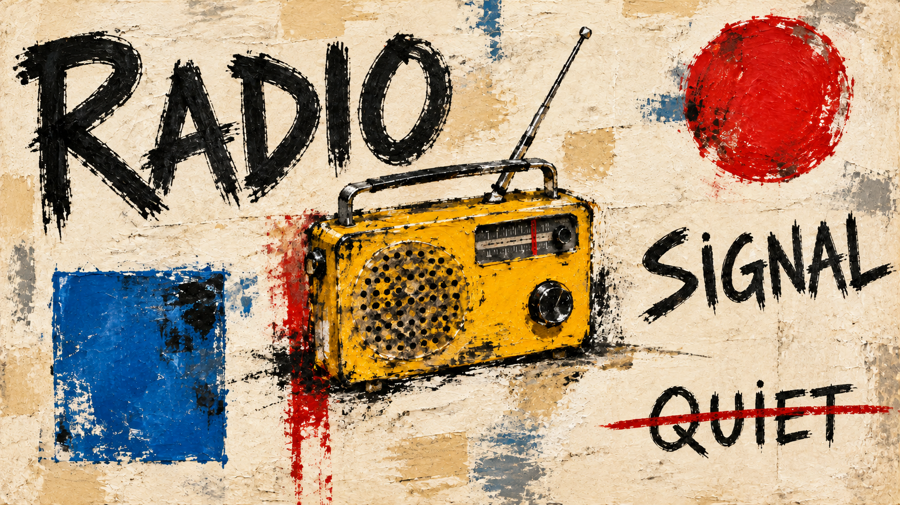

# Basquiat direction comparison

Both images show the same yellow portable radio, the exact words `RADIO`, `SIGNAL`, and `QUIET`, one blue square, and one red circle. `QUIET` is crossed out once and remains legible.

| Legacy package | `user-authored-mark-hierarchy` direction |
| --- | --- |
|  |  |

The direction image gives `RADIO` stronger emphasis, keeps `SIGNAL` secondary, and localizes the red strike-through to `QUIET`. The edit preserves the overall composition by using the legacy image as a reference. It also introduces a few incidental blue flecks near the text, so mark containment is not perfect; review this as an experimental sample, not as a guaranteed output.

Compiled jobs: [`legacy-job.json`](legacy-job.json) and [`direction-job.json`](direction-job.json). Exact generation prompts and edit method: [`generation-prompts.md`](generation-prompts.md). The images are 1672 × 940/941 pixels (approximately 16:9).
