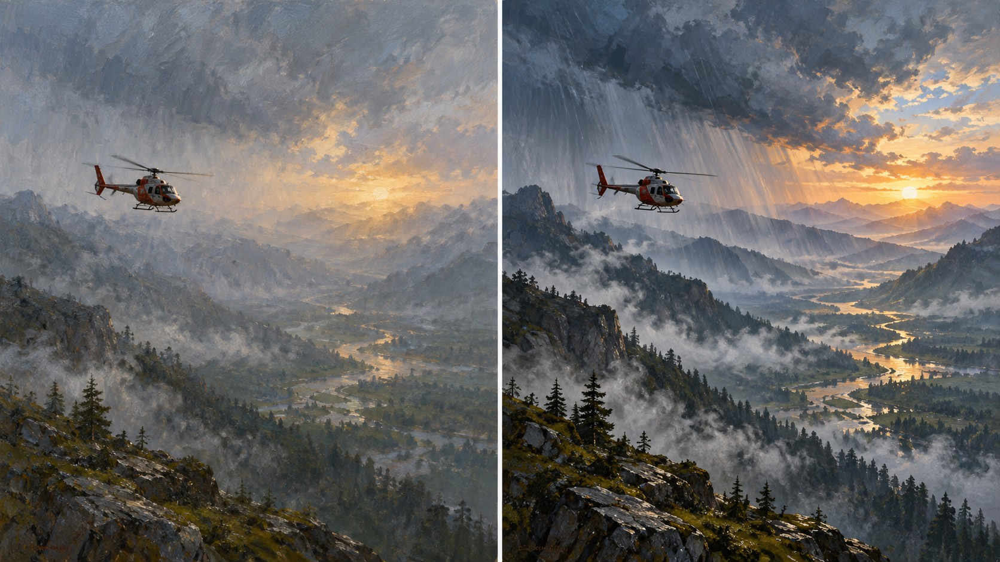

# 新旧架构视觉对照

- **同一输入主题：** `A rescue helicopter crossing a rain-dark valley at sunrise`
- **图像形式：** 单张左右拼图（左：旧版包默认规则；右：新版方向规则）。
- **任务记录：** [旧版编译任务](legacy-job.json)、[新版方向编译任务](direction-job.json)。
- **人工复核：** 两图均保留穿越雨暗山谷的救援直升机。新版增加了可辨的日轮、斜射光束和更深的前景山体，金色河谷与冷灰风暴形成更强明暗层次；旧版光线更散、远景雾化更均匀。直升机仍是视觉主体，场景没有明显缺项。新版方向性光线与明暗对照可见，但整体也接近通用电影概念画，不能单凭此图确认透纳特征或跨题材稳定性。
- **限制：** 两版由独立生图调用完成，没有固定随机种子，不能单独证明差异由架构规则造成，也不能证明规则跨题材稳定。包状态继续保持 `experimental`，需要更多主题与人工复核。
