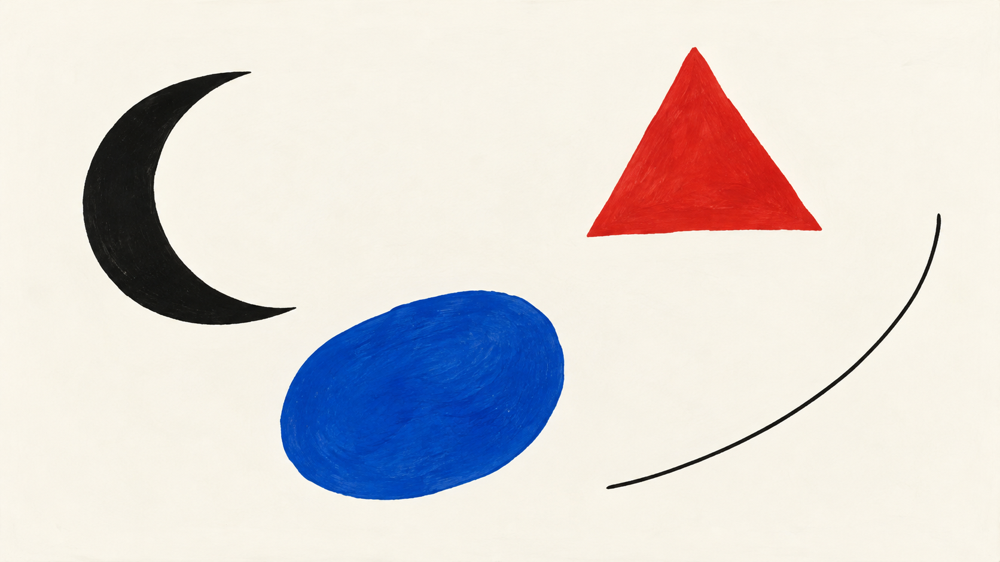
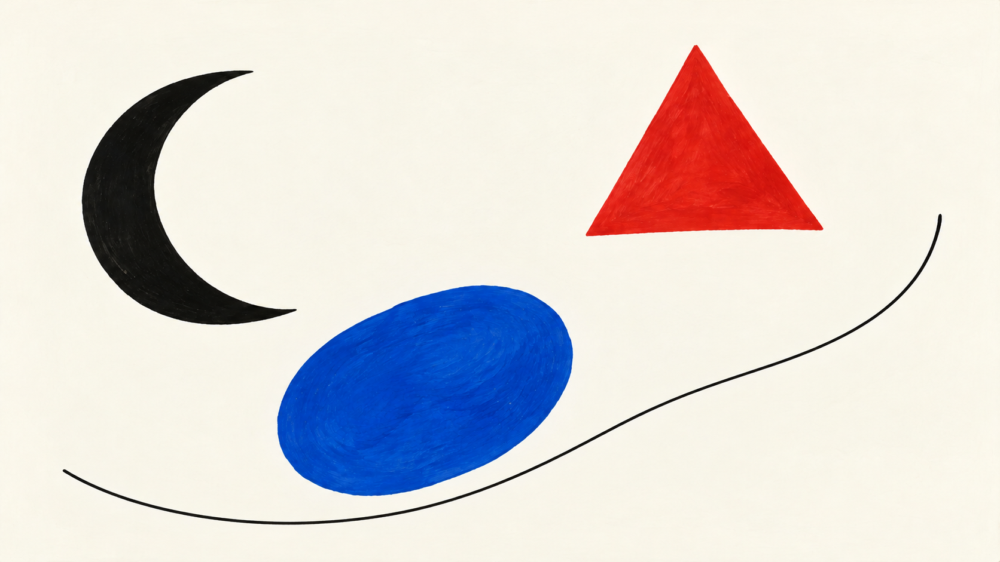

# Miró direction comparison

Both images contain exactly the same four requested marks on a warm-white ground: a black crescent, a red triangle, a cobalt-blue irregular oval, and a thin black curved line.

| Legacy package | `suspended-biomorphic-sign-field` direction |
| --- | --- |
|  |  |

The direction image uses the curve as a longer loose path beneath the color forms, preserving separation between the crescent, triangle, and oval while keeping open ground. It was generated by editing the legacy image as a composition reference, so the requested forms remain aligned. The visual difference is intentionally subtle and should be reviewed in context; the direction is still experimental.

Compiled jobs: [`legacy-job.json`](legacy-job.json) and [`direction-job.json`](direction-job.json). Exact prompts and the reference-edit method: [`generation-prompts.md`](generation-prompts.md). Both images are 1672 × 941 pixels (approximately 16:9).
