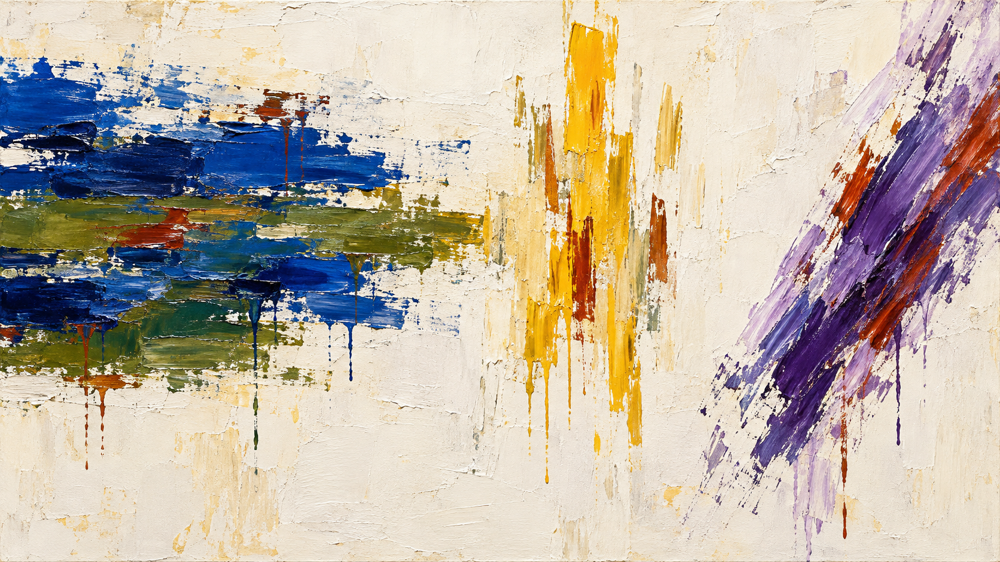
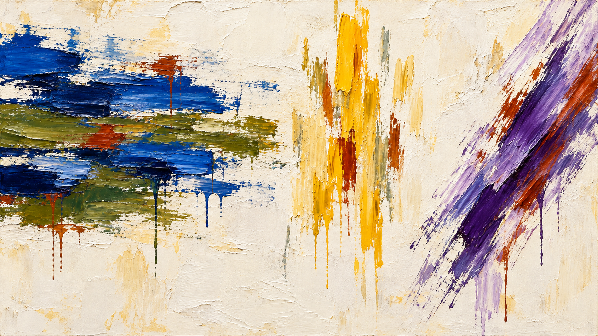

# Joan Mitchell direction comparison

Both images use the same three color groups on a broad warm-white ground: cobalt and olive horizontal strokes at left, short yellow vertical strokes near center, and a violet diagonal cluster at right. No objects or horizon were requested.

| Legacy package | `counterposed-color-stroke-groups` direction |
| --- | --- |
|  |  |

The direction result makes paint thickness and stroke variation more pronounced, while preserving broad ground intervals between the groups. The direction image was generated from the legacy image as a composition reference, so the cluster locations and palette stay aligned. The generated impasto is stronger than the prompt's neutral baseline and remains a review point; this sample does not guarantee identical behavior across image models.

Compiled jobs: [`legacy-job.json`](legacy-job.json) and [`direction-job.json`](direction-job.json). Exact prompts and edit method: [`generation-prompts.md`](generation-prompts.md). Both images are 1672 × 941 pixels (approximately 16:9).
