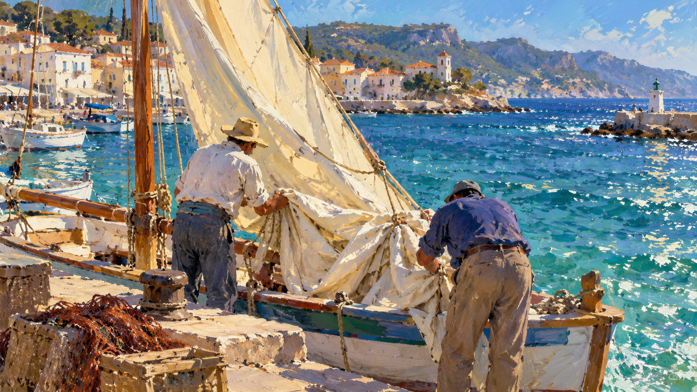

# Joaquín Sorolla

[中文版](README.md)



> **Category:** artist  
> **Medium:** oil painting  
> **Path:** `style-packages/artists/joaquin-sorolla`

## Overview

This package extracts transferable decisions from Sorolla's outdoor oil painting: how strong daylight organizes value and color, how water, pale cloth, and ground reflect local color into shadows, and how quick directional marks describe both form and movement. The bright palette remains organized by value, keeping forms legible and the observation immediate.

It does not make beaches, sailboats, or figures mandatory subjects. The style package applies its decisions about light, color, and brushwork to the subject and setting supplied by the user.

## Distinction from nearby painters

- **Monet:** places greater emphasis on atmospheric and weather-driven color vibration; this profile stresses strong sunlight, reflected light, and clearer broad forms with local contrast.
- **Renoir:** often centers soft figure modeling and warm flesh; this profile lets hard daylight, white highlights, and reflected environment shape form.
- **Van Gogh:** uses emotional contours and rhythmic marks to drive a scene; this profile directs marks along water, folds, leaves, and turns of form.
- **Turner:** often dissolves boundaries into weather and atmosphere; this profile retains readable forms while using direct light and reflected color to convey open air.

## Package contents

- `identity.yaml`: scope, open-subject policy, and exclusions
- `visual-signature.yaml`: visual traits that survive a subject change
- `art-direction.yaml`: the complete opt-in direction under the new architecture, currently version 0.2.0; still experimental and enabled explicitly with `--direction package`; default compilation is unchanged
- `reproduction.yaml`: construction from broad color masses to selected strokes
- `prompts/base.txt`, `prompts/negative.txt`: base prompt and negative constraints
- `palette/palette.json`: color roles and values
- `evaluation.yaml`: style and subject checks
- `references/manifest.csv`, `provenance.yaml`: museum sources and rights boundaries
- `examples/generated/`: local-only unreviewed candidates; PNG candidates are not tracked by default

## New direction rules

The new direction turns “Sorolla-like daylight” into executable, inspectable decisions: establish a key-light direction and model with value; require a visible environmental cause for reflected color and keep it subordinate to the key light; vary marks with water, folds, foliage, and turning planes; use bold viewpoints and crops only when they strengthen the subject. A warm filter, coastal subject, or tilted composition is never a fixed template.

Each rule states when it applies, what to do, what should be visible, and what result to reject. Joint checks require the light, reflected color, value grouping, marks, and composition to cohere. Visual review is still pending, so this is a creative specification to evaluate, not a claim that image results have passed review. `evaluation.yaml` calls for non-coastal subjects, including an indoor scene with direct sunlight entering through a window, to check subject preservation and cross-subject stability.

## Sources and rights

The references link to material from the National Gallery, London, the Museo del Prado, and Museo Sorolla. They support research into outdoor painting, strong light, reflected color, water, and compositional cropping. No source artwork images are bundled.

The representative image is an anonymous new scene created with an image-generation tool. It is not an original, reproduction, or authorized work by Sorolla and does not imply an affiliation with the artist or any museum.

## Use

Replace `{SUBJECT}`, `{LOCATION}`, and `{SUBJECT_ACTION}` with your request, then provide the base prompt, negative constraints, and palette to your image workflow. The package controls medium and visual treatment; it should not add a beach, boat, sail, or fixed narrative unless requested.

To try the new direction rules, declare their applicable context and explicitly compile them:

```powershell
python tools/compile-style.py style-packages/artists/joaquin-sorolla --direction package --context daylight --subject "A courtyard chair in afternoon daylight, no people or water" --output runs/sorolla-v2-job.json
```

This direction has not completed image comparison review. Ordinary compilation continues to use the legacy path. The new rules do not replace `visual-signature.yaml`, the base prompts, or the palette, so the experiment does not silently change existing output.

After generation, use `evaluation.yaml` to check the requested subject, the role of direct and reflected light in form, and whether brush marks follow material and movement. Do not judge the result only by how bright its colors are.
