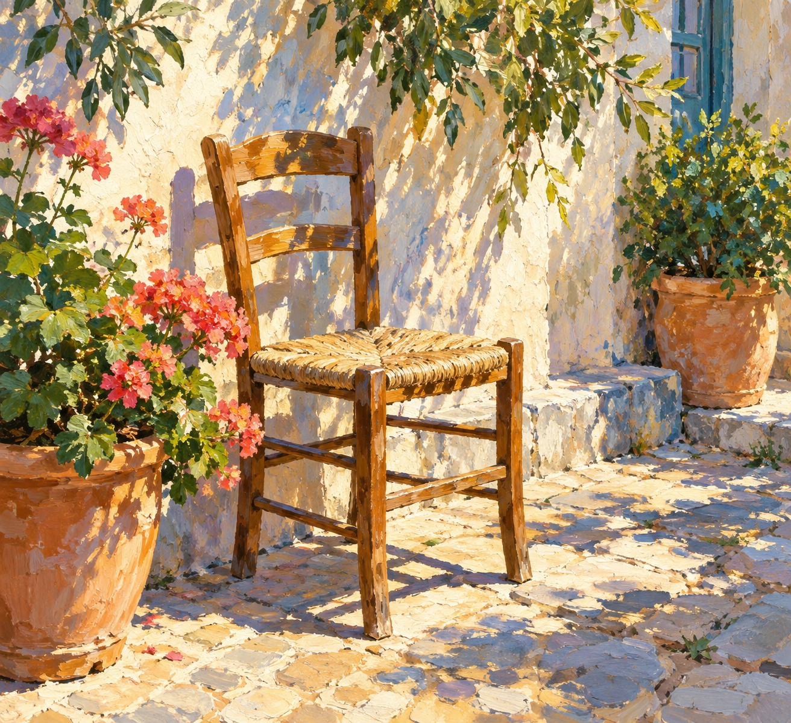
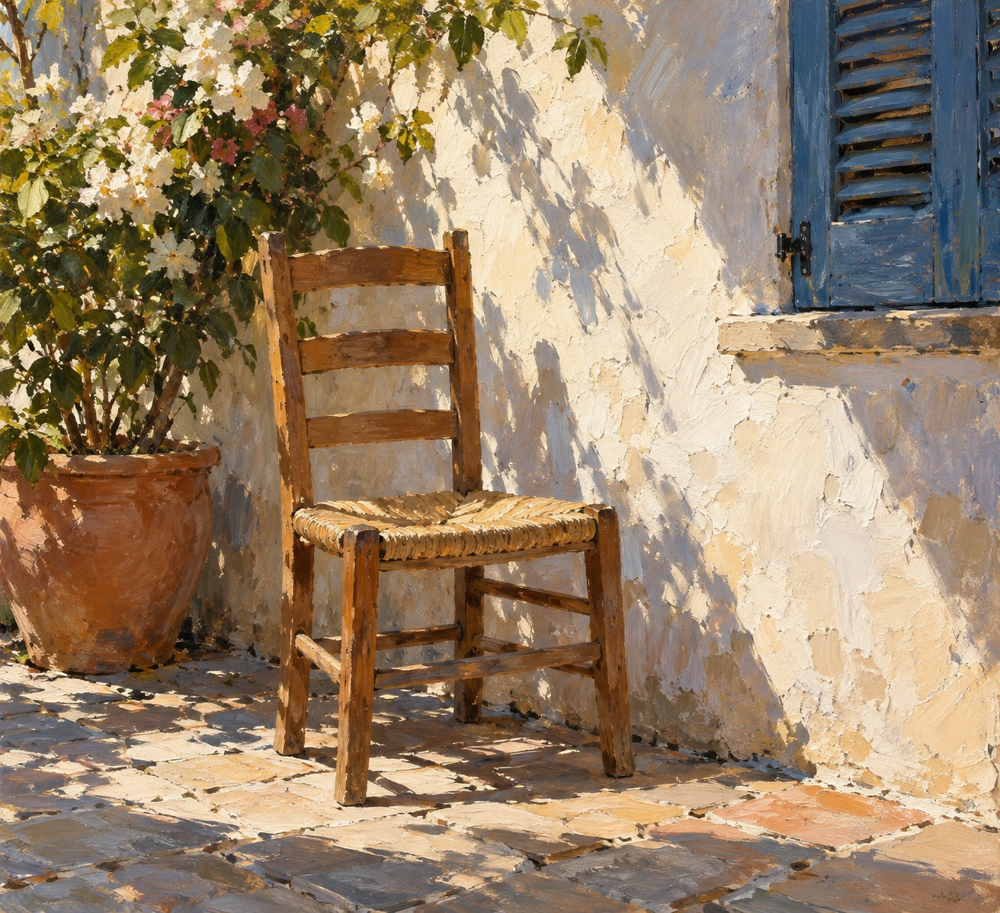

# 新旧架构实际生图对照

| 旧版包默认规则 | 新版方向规则 |
|---|---|
|  |  |

- **同一输入主题：** `A wooden chair by a sunlit courtyard wall, no people or water`
- **编译任务：** [旧版任务](legacy-compiled-job.json)、[新版方向任务](direction-compiled-job.json)，均由当前仓库编译器生成。
- **生成记录：** 两图使用编译任务中的提示词和负面约束，分别通过 OpenAI imagegen 生成。工具未提供随机种子，未控制随机性。
- **人工复核：** 两图都保留一把庭院木椅；新版把直射日光、墙面受光和叶影笔触表现得更明确，构图变化较小，差异属于细微到中等。
- **限制：** 单个题材的独立生成不能证明方向跨主题稳定或差异必然由规则造成；方向保持 `experimental`。
