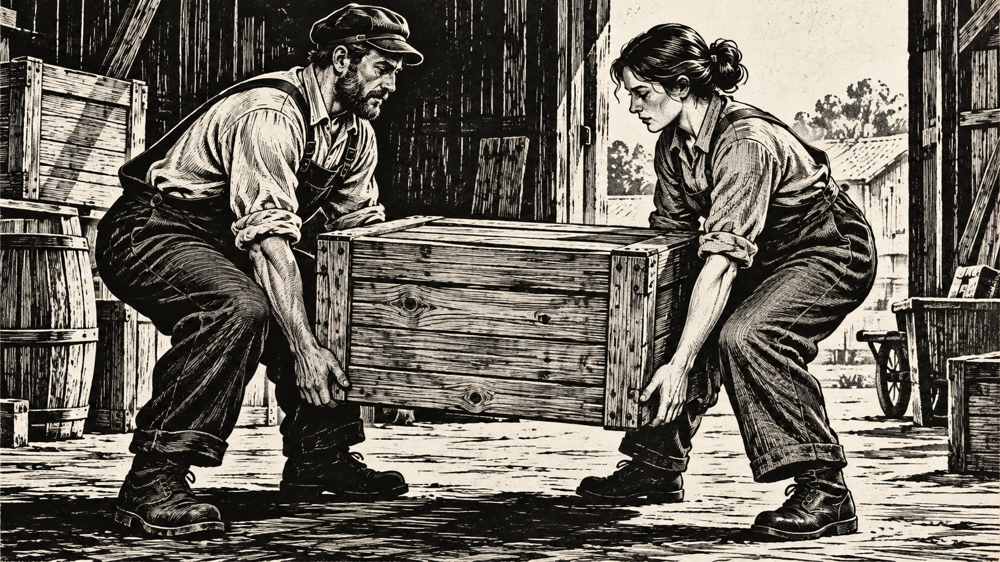
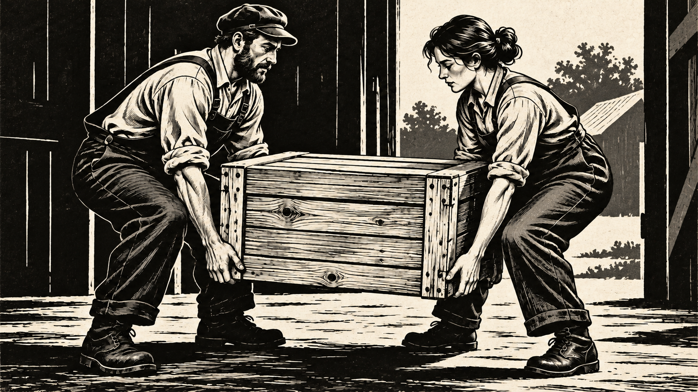

# 凯绥·珂勒惠支

[English](README.en.md)

> **分类：** 艺术家  
> **媒介领域：** 黑白版画与炭笔素描  
> **目录：** style-packages/artists/kathe-kollwitz

## 简介

凯绥·珂勒惠支把版画当成直接而有重量的视觉语言。她的画面常用密集线网、大块黑色和有限灰阶，把普通形体压缩成清楚、沉着又带着情绪压力的结构。这个包提取的是线性、明暗和纸面关系，不把苦难题材写成默认内容。

## 策展短评

我喜欢这个方向里“少一点颜色，反而更接近重量”的感觉。它适合先把主体的轮廓和重心说清楚，再让线条承担质感与情绪。若只套一层黑白滤镜，画面会显得空；真正重要的是黑块怎么落下、灰阶在哪里停住，以及纸面如何保留手工痕迹。

## 主体独立性

本包只决定版画媒介、黑白阶调、线性结构和纸面质感，不规定人物、物体、地点或故事。代表图中的工作室物件只是测试主体。

## 可选新方向：压缩人物群像

`art-direction.yaml` 使用方向格式 2.1.0，登记一个实验构图方向，仅用于用户已指定人物互动或共同动作的多人物场景。它把人物重心围绕动作接触点组织。需要黑白版画块面或材料刻线时，可分别声明 `black-print-masses-on-light-paper` 和 `shadows-or-materials-need-printed-texture` 启用相应规则。它不会替用户推断亲属关系、悲伤、冲突或政治叙事。编译新版方向时显式声明 `compressed-figure-group-print`。

### 同一场景的生成对照

两张图都表现两位成年人合力搬动木箱。右图是对左图的新版方向编辑：背景收敛为更大的黑色块面，人物、木箱和手臂关系更集中；细节仍有模型改写，尤其木箱与衣褶纹路，因此该对照展示的是方向差异，不是确定性渲染结果。

| 旧版默认路径 | 新版群像方向 |
| --- | --- |
|  |  |

查看编译任务：[`legacy-job.json`](comparisons/legacy-job.json)、[`direction-job.json`](comparisons/direction-job.json)；生成提示和评审记录：[`generation-prompts.md`](comparisons/generation-prompts.md)。

## 来源与版权

研究入口为[现代艺术博物馆的凯绥·珂勒惠支档案](https://www.moma.org/collection/artists/3201)。仓库不打包外部作品；代表图是新的匿名场景，不是具体原作，也不表示合作、授权或背书关系。

## 只使用此包

### 方式一：交给有生图能力的 Agent

把整个风格包目录交给 Agent，先读取 identity.yaml、visual-signature.yaml、reproduction.yaml、prompts/、palette/palette.json 和 evaluation.yaml，再把你的主体、画幅和用途编译进生成任务。

### 方式二：直接复制 Prompt

复制 prompts/base.txt，替换主体、地点和画幅；把 prompts/negative.txt 一并提交。

### 方式三：配置 API Key 后提交生成

在你自己的生图平台或编译工具中配置 API Key，提交基础 Prompt、负面约束和调色板。本仓库不托管密钥或在线生图服务。

### 方式四：本地模型 + ComfyUI

将 Prompt、调色板和复现说明接入本地模型或 ComfyUI，生成后用 evaluation.yaml 检查线性、阶调、主体可读性和固定题材泄漏。
