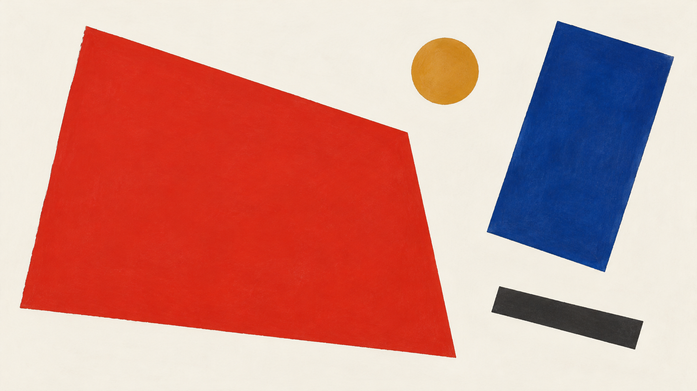
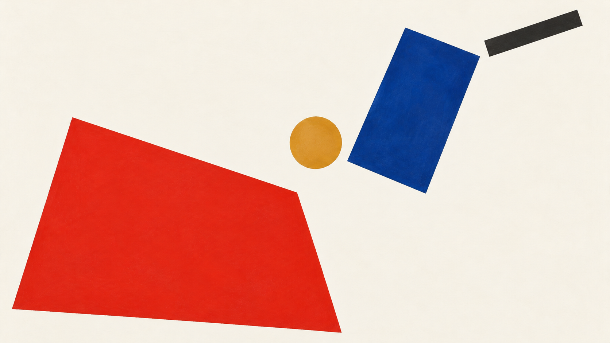

# Kazimir Malevich

[中文版](README.md)


> **Category:** artist
> **Domain:** painting
> **Path:** `style-packages/artists/kazimir-malevich`

## Overview

以悬浮的几何形体、非对象化空间和极少的色彩关系，建立不依赖具体物件的纯粹秩序。

This is an independently usable style package. It turns observable medium,
composition, lighting, color, surface, texture, and reproduction decisions into
executable guidance for new subjects. It is not intended to reproduce a specific
work.

## Curatorial note

Malevich's force comes from reduction: when objects no longer carry the narrative, proportion, direction, interval, and color relationships become the subject. This package translates a user-supplied idea into a clear plane-based order without repeatedly generating a signature geometric replica.

## Subject independence

This package controls *how* an image is generated, not *what* it depicts.
People, objects, places, architecture, plants, vehicles, and narrative come
from your prompt. Concrete scenes in this package are examples or tests only
and must never be added as default content.

## Optional direction: diagonal drift and counterweight

`art-direction.yaml` uses direction format 2.1.0 and registers an experimental direction for user-requested non-objective geometric compositions. It connects unequal forms along an off-center diagonal movement. Declare `multiple-geometric-forms-with-distinct-color-or-scale` and `light-or-neutral-ground-around-floating-forms` only when those elements are present to activate counterweight and open-ground rules. This narrows the legacy package's general floating-geometry rules without prescribing a fixed color-and-shape recipe. Explicitly declare `diagonal-drift-counterweight` when compiling. The new direction is optional; the legacy default is unchanged.

### Generated comparison using the same four forms

Both images use the same four geometric forms. The direction version places the large red plane at lower left, then balances it with a tilted blue plane, ochre circle, and charcoal bar along a rising route. The edit retains the shape count and color roles, but their positions and angles vary slightly. This illustrates a compositional change rather than precise layout rendering.

| Legacy default path | New diagonal-drift direction |
| --- | --- |
|  |  |

Compiled jobs: [`legacy-job.json`](comparisons/legacy-job.json), [`direction-job.json`](comparisons/direction-job.json). Generation prompts and review: [`generation-prompts.md`](comparisons/generation-prompts.md).

## Read before use

- `identity.yaml`: scope, subjects, and exclusions
- `visual-signature.yaml`: features that should survive a subject change
- `reproduction.yaml`: medium, materials, and construction order
- `prompts/base.txt`, `prompts/negative.txt`: prompt constraints
- `palette/palette.json`: color roles and values
- `evaluation.yaml`: post-generation checks
- `references/manifest.csv`, `provenance.yaml`: sources and rights boundaries

## Sources and rights

References are used for research and visual analysis. External artworks,
photographs, game imagery, trademarks, and platform pages remain the property of
their respective rights holders. Generated examples are new anonymous scenes and
are not original works by, or endorsements from, the referenced person, movement,
school, or game.

See [`provenance.yaml`](provenance.yaml),
[`references/manifest.csv`](references/manifest.csv), and the repository
[`NOTICE`](../../../NOTICE) for source and redistribution boundaries.

## Use only this package

Choose one of the following methods.

### Method 1: Give the package to an image-capable Agent

Upload this package directory to an Agent, or provide its local path, and ask:

```text
Use this style package to help me generate an image.

First read identity.yaml, visual-signature.yaml, reproduction.yaml,
prompts/base.txt, prompts/negative.txt, palette/palette.json, and evaluation.yaml.
Compile their rules into the generation process. Do not use only the style name
as a prompt and do not copy a reference work.

My image request is:
<subject, objects, scene, aspect ratio, and purpose>

Compile the full prompt first, then generate the image. After generation, check
style features, composition, color, material, AI artifacts, and request adherence
against evaluation.yaml, and report remaining risks.
```

### Method 2: Copy the prompts

Replace the subject, objects, scene, and aspect ratio in `prompts/base.txt` and
send `prompts/negative.txt` as the negative prompt. Use the visual signature and
palette for tighter control.

### Method 3: Submit through your own API tool

Configure your API key in your own image platform or prompt compiler, then submit
the base prompt, negative constraints, palette, and any required reference list.
The repository does not host a generation service or manage API keys.

### Method 4: Local model + ComfyUI

Connect the prompts to a local model or ComfyUI workflow. Use the palette,
reproduction notes, and reference manifest to set color, composition, material,
and lighting. Review the output against `evaluation.yaml`.

Users manage model weights, API keys, and generated images themselves. References
are for observable traits only; do not copy a source work's exact composition,
figures, text, trademark, or logo.
