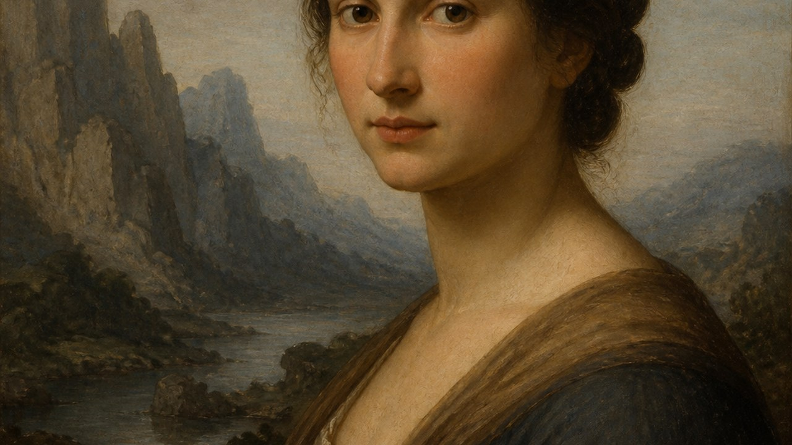
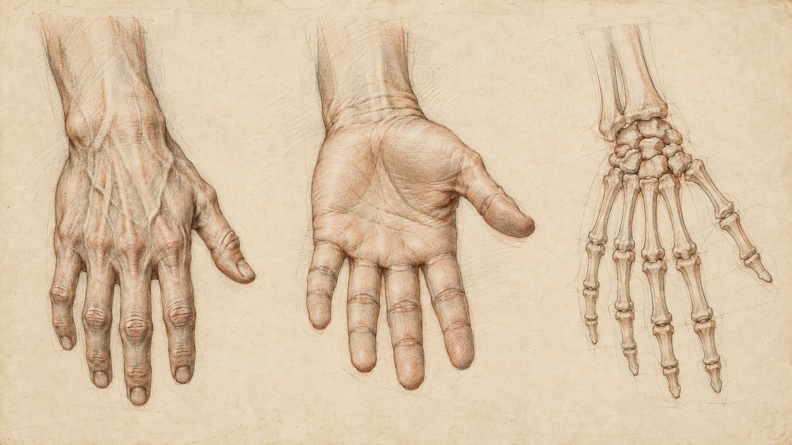
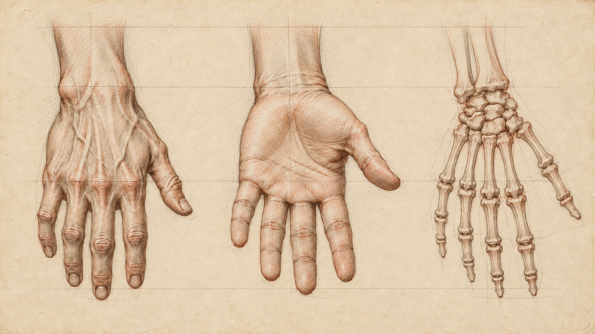

# 莱昂纳多·达·芬奇

[English](README.en.md)



> **分类：** 艺术家
> **类型：** 艺术家
> **目录：** `style-packages/artists/leonardo-da-vinci`

## 简介

这是一个面向「莱昂纳多·达·芬奇」的独立风格包。它把公开作品、研究资料和可观察的媒介、构图、色彩、光线、材质与纹理决策整理为可执行约束，用于生成新的主题，不用于复制某一幅具体作品。

## 策展短评

这个方向的气质落在“晕涂、观察性解剖、空气透视与自然研究”上。保住这条线索，换成新的主体也能成立。

## 风格重点

晕涂、观察性解剖、空气透视与自然研究。Prompt 会优先表达这些可观察特征，同时保留新主题、新构图和新的对象关系。

完整规则见 `visual-signature.yaml`、`reproduction.yaml`、`palette/palette.json` 和 `evaluation.yaml`。

## 可选新方向：分层手部结构研究

`art-direction.yaml` 使用方向格式 2.1.0，登记一个实验性绘图方向，仅用于用户要求的手部或腕部多视图解剖习作。它把手背、掌面与骨骼等不同视图作为同一对象的比较研究，尽量对齐腕部入口和关节轴。只有用户同时要求外部形态与内部结构时，才声明 `external-and-internal-hand-structure-requested` 启用分层观察规则；纸上绘图标记也可按需启用。它不提供医疗解释，也不自动添加标签。编译时显式声明 `layered-hand-mechanics-study`；原有艺术家包和旧版默认路径保留。

### 同一张手部研究页的生成对照

两张图都包含手背、掌面和骨骼三个视图。新版把腕部基线和构造轴联系得更明确，页内比较关系更强；模型同时改写了一些手指细节，不能把它当成准确的医学图或确定性绘图结果。

| 旧版默认路径 | 新版分层手部研究 |
| --- | --- |
|  |  |

编译任务：[`legacy-job.json`](comparisons/legacy-job.json)、[`direction-job.json`](comparisons/direction-job.json)；提示与评审：[`generation-prompts.md`](comparisons/generation-prompts.md)。

## 参考来源

- [Leonardo da Vinci / 文艺复兴盛期](https://commons.wikimedia.org/w/index.php?search=Leonardo+da+Vinci&title=Special:MediaSearch&type=image)

## 来源与版权

参考链接只用于研究和视觉分析。外部作品、摄影作品、游戏画面、商标和平台页面仍归原权利人所有；本包不重新分发受版权保护的原作。代表图是新的匿名生成场景，不是相关艺术家、摄影师、设计师或游戏的原作，也不代表合作或授权关系。

详细来源和再分发边界见 [`provenance.yaml`](provenance.yaml)、[`references/manifest.csv`](references/manifest.csv) 和仓库的 [`NOTICE`](../../../NOTICE)。

## 只使用此包

四种方式可以按手边的工具任选其一，不需要同时使用。

### 方式一：交给有生图能力的 Agent

把整个风格包目录上传给具备生图能力的 Agent，或把本地目录路径交给它，并附上下面的任务说明：

```
请使用这个风格包帮助我生成图片。

请先读取本目录中的：
- identity.yaml
- visual-signature.yaml
- reproduction.yaml
- prompts/base.txt
- prompts/negative.txt
- palette/palette.json
- evaluation.yaml

请把这些文件中的规则整合到生成流程中，不要只把风格名称当作 Prompt，也不要复制参考作品。

我的生成需求是：
<填写人物、物体、场景、画幅和用途>

请先把我的需求编译成完整 Prompt，再调用你的生图能力生成图片。生成后，请按照 evaluation.yaml 检查风格特征、构图、颜色、材质、AI 痕迹和 Prompt 遵循度；如果发现明显问题，请说明问题并进行一次针对性修正。
```

### 方式二：直接复制 Prompt

打开 `prompts/base.txt`，将其中的主题、人物、物体、场景和画幅替换为自己的需求；把 `prompts/negative.txt` 中的限制作为负面 Prompt 一并提交到支持文本生图的平台。需要更稳定时，同时参考 `visual-signature.yaml` 和 `palette/palette.json`。

### 方式三：配置 API Key 后提交生成

在你使用的生图平台或自己的编译工具中配置 API Key，将本包的基础 Prompt、负面约束、调色板和必要的参考图一起提交。API Key 只保存在你自己的环境中；本仓库不代管密钥、不托管在线生成服务，也不承诺某个平台的免费额度或接口兼容性。

### 方式四：本地模型 + ComfyUI

将 `prompts/base.txt` 和 `prompts/negative.txt` 接入本地模型或 ComfyUI 工作流；按 `palette/palette.json` 调整颜色，按 `references/manifest.csv` 选择参考图，并用 `reproduction.yaml` 中的参数约束构图、材质和光线。生成后可用 `evaluation.yaml` 做人工或自动复核。

参考图只用于理解可观察特征，不要复制原作的具体构图、人物、文字、商标或标志。模型权重、API Key 和生成图片由使用者自行管理。
