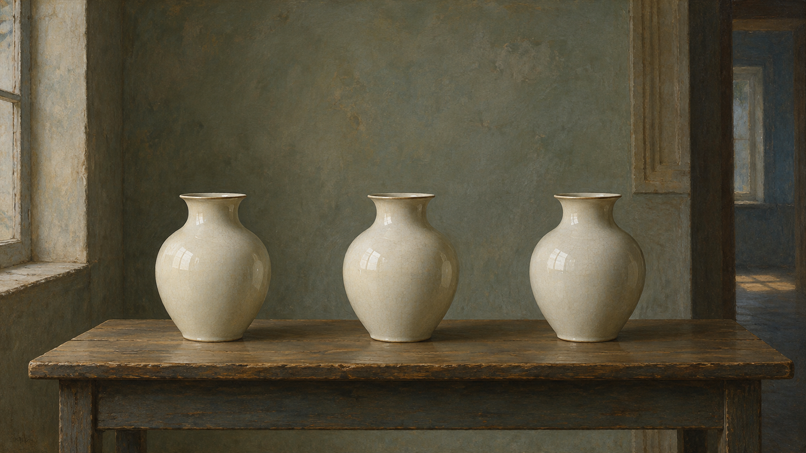
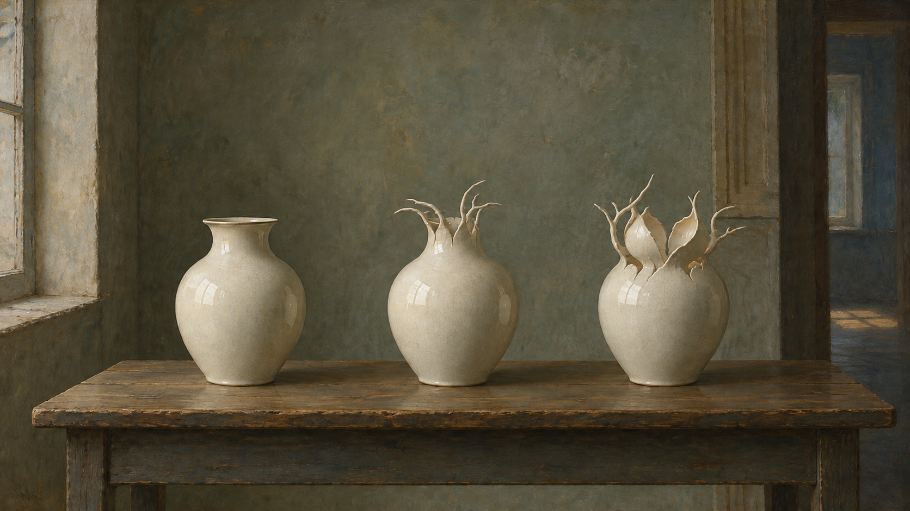

# Leonora Carrington

[中文版](README.md)


> **Category:** artist
> **Domain:** painting
> **Path:** `style-packages/artists/leonora-carrington`

## Overview

Surreal painting built from dreamlike beings, alchemical motifs, fine contours, and cool mysterious spaces with deliberately ambiguous imagery.

This is an independently usable style package. It turns observable medium,
composition, lighting, color, surface, texture, and reproduction decisions into
executable guidance for new subjects. It is not intended to reproduce a specific
work.

## Curatorial note

“precise contours, enigmatic beings, alchemical suggestion, and a cool space open to more than one reading” is the useful entry point: it arranges the image’s breathing room before the subject arrives.

## Read before use

- `identity.yaml`: scope, subjects, and exclusions
- `visual-signature.yaml`: features that should survive a subject change
- `reproduction.yaml`: medium, materials, and construction order
- `prompts/base.txt`, `prompts/negative.txt`: prompt constraints
- `palette/palette.json`: color roles and values
- `evaluation.yaml`: post-generation checks
- `references/manifest.csv`, `provenance.yaml`: sources and rights boundaries

## Optional direction: three-state material metamorphosis

The `art-direction.yaml` file uses direction format 2.1.0 and registers an experimental direction that activates only when the user explicitly asks for an object transformation or sequence of states. It organizes one object as intact, transitional, and changed forms. Add `transformation-has-intermediate-or-hybrid-state` or `transformation-uses-shared-stable-setting` only when those conditions apply to activate the matching rules. The source object remains traceable through the change; animals, faces, occult symbols, or a story are not added by default. Declare `three-state-material-metamorphosis` when compiling; the legacy default path stays unchanged.

### Generated comparison using the same vessels

Both images use three pale ceramic vessels on a table. The direction version turns them into a gradual sequence from intact vessels to branching rims and a seedpod-like ceramic form, while keeping the room and lighting steady. Fine contours still vary because of image generation, so this is a visual direction sample rather than deterministic shape animation.

| Legacy default path | New three-state metamorphosis |
| --- | --- |
|  |  |

Compiled jobs: [legacy-job.json](comparisons/legacy-job.json), [direction-job.json](comparisons/direction-job.json). Generation prompts and review notes: [generation-prompts.md](comparisons/generation-prompts.md).

## Sources and rights

References are used for research and visual analysis. External artworks,
photographs, game imagery, trademarks, and platform pages remain the property of
their respective rights holders. Generated examples are new anonymous scenes and
are not original works by, or endorsements from, the referenced person, movement,
school, or game.

See [`provenance.yaml`](provenance.yaml),
[`references/manifest.csv`](references/manifest.csv), and the repository
[`NOTICE`](../../../NOTICE) for source and redistribution boundaries.

## Use only this package

Choose one of the following methods.

### Method 1: Give the package to an image-capable Agent

Upload this package directory to an Agent, or provide its local path, and ask:

```text
Use this style package to help me generate an image.

First read identity.yaml, visual-signature.yaml, reproduction.yaml,
prompts/base.txt, prompts/negative.txt, palette/palette.json, and evaluation.yaml.
Compile their rules into the generation process. Do not use only the style name
as a prompt and do not copy a reference work.

My image request is:
<subject, objects, scene, aspect ratio, and purpose>

Compile the full prompt first, then generate the image. After generation, check
style features, composition, color, material, AI artifacts, and request adherence
against evaluation.yaml, and report remaining risks.
```

### Method 2: Copy the prompts

Replace the subject, objects, scene, and aspect ratio in `prompts/base.txt` and
send `prompts/negative.txt` as the negative prompt. Use the visual signature and
palette for tighter control.

### Method 3: Submit through your own API tool

Configure your API key in your own image platform or prompt compiler, then submit
the base prompt, negative constraints, palette, and any required reference list.
The repository does not host a generation service or manage API keys.

### Method 4: Local model + ComfyUI

Connect the prompts to a local model or ComfyUI workflow. Use the palette,
reproduction notes, and reference manifest to set color, composition, material,
and lighting. Review the output against `evaluation.yaml`.

Users manage model weights, API keys, and generated images themselves. References
are for observable traits only; do not copy a source work's exact composition,
figures, text, trademark, or logo.
