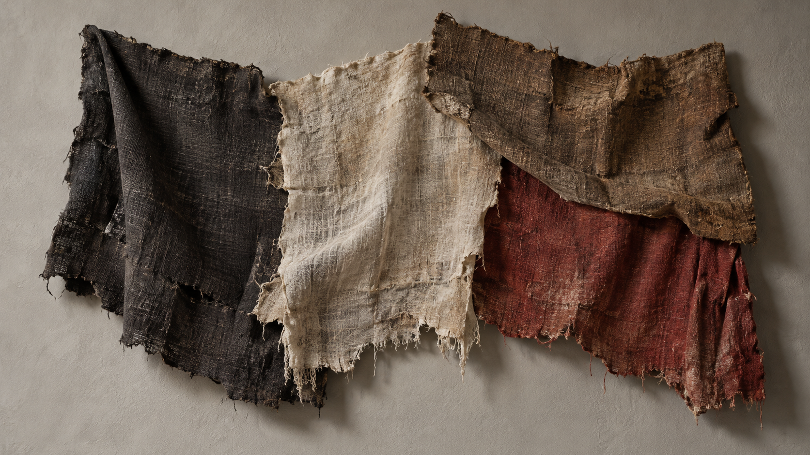
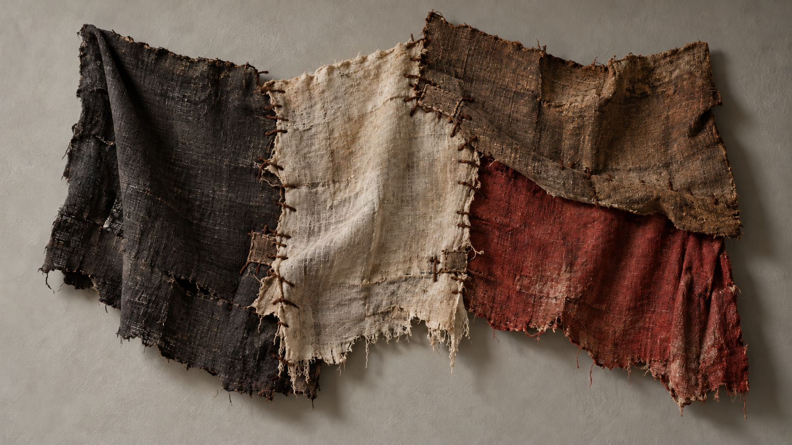

# Louise Bourgeois

[中文版](README.md)

> **Category:** artist  
> **Domain:** hybrid  
> **Path:** `style-packages/artists/louise-bourgeois`

## Overview

This package places organic curves, architectural frames, compressed space, and rough material evidence inside one transferable visual system. It focuses on tension between forms, pressure carried by voids, and traces of repair, indentation, and handwork.

## Curatorial note

The image does not need to explain a story first. Let weight emerge between forms: a firm frame gives the subject a boundary, while a curved line and uneven surface push that boundary slightly open. Start with an ordinary subject and let material and negative space carry the feeling; no symbolic object is required.

## Subject independence

This package controls visual treatment, not subject matter. People, objects, places, architecture, plants, and narrative come from the request. Objects in the example are tests only and are never default output requirements.

## Optional direction: visible textile mending

The `art-direction.yaml` file uses direction format 2.1.0 and registers an experimental direction for user-requested fabric assembly, seams, or visible repair. Stitches cross actual joins; declare `user-requests-repaired-or-timeworn-fabric` or `fragments-assembled-on-visible-ground` only when applicable to activate localized wear or textile-relief rules. It does not infer personal memory or add needles, spools, spiders, cages, or body imagery by default. Declare `visible-mending-textile-assembly` when compiling; the legacy package and default path remain unchanged.

### Generated comparison using the same fabric fragments

Both images show an assemblage of four torn fabric pieces. The direction version adds dark hand stitches and local patches along the seams, making the joining itself a visible structure. The model still changes some edges and stitch spacing, so this is not a precise textile-process simulation.

| Legacy default path | New visible-mending direction |
| --- | --- |
|  |  |

Compiled jobs: [legacy-job.json](comparisons/legacy-job.json), [direction-job.json](comparisons/direction-job.json). Prompts and review notes: [generation-prompts.md](comparisons/generation-prompts.md).

## Sources and rights

Observable traits were studied from the [MoMA artist page](https://www.moma.org/artists/710-louise-bourgeois) and the [artist biography](https://lb.moma.org/about/biography). External works remain with their rights holders; this repository keeps links only and makes no claim of affiliation, authorization, or endorsement.

## Read before use

- `identity.yaml`: scope and subject boundaries
- `visual-signature.yaml`: features that should survive a subject change
- `reproduction.yaml`: materials and construction order
- `prompts/base.txt`, `prompts/negative.txt`: prompt constraints
- `palette/palette.json`: color roles
- `evaluation.yaml`: post-generation checks

## Use only this package

Choose one method:

1. **Image-capable Agent:** upload this directory or provide its path. Ask the Agent to read the files above, compile a prompt for your subject, generate the image, and review it against `evaluation.yaml`.
2. **Copy the prompts:** replace subject, location, aspect ratio, and purpose in `prompts/base.txt`, then submit `prompts/negative.txt` as negative guidance.
3. **Use your own API:** configure an API key on your chosen platform and submit the prompt, negative constraints, palette, and any needed reference links. Keep the key yourself.
4. **Local model and ComfyUI:** connect the prompts to your workflow, use the palette and reproduction notes for material and light, then review the output with the evaluation file.

References are for observable traits only. Do not copy a source work’s composition, figures, text, trademark, or logo.
