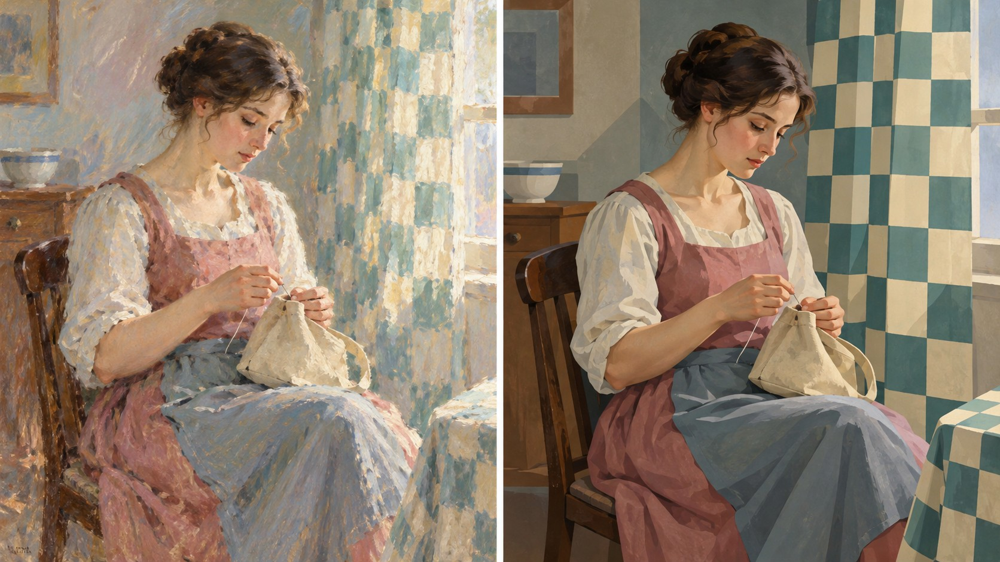

# 新旧架构视觉对照

- **同一输入主题：** `An adult repairing a canvas bag beside a patterned curtain`
- **图像形式：** 单张左右拼图（左：旧版包默认规则；右：新版方向规则）。
- **任务记录：** [旧版编译任务](legacy-job.json)、[新版方向编译任务](direction-job.json)。
- **人工复核：** 两图均表现成人坐着缝补帆布包，人物姿势、衣着和手部动作一致。旧版以柔和断续笔触处理室内光线和帘布；新版把右侧帘布组织成清楚的蓝绿色棋盘纹样，并用更平整的色面围合人物，缝补动作仍可辨。图案对应了输入中的“有纹样帘布”，不是额外主体。新版的结构化背景差异可见，但对卡萨特个人特征的代表性及跨题材稳定性仍需更多样本。
- **限制：** 两版由独立生图调用完成，没有固定随机种子，不能单独证明差异由架构规则造成，也不能证明规则跨题材稳定。包状态继续保持 `experimental`，需要更多主题与人工复核。
