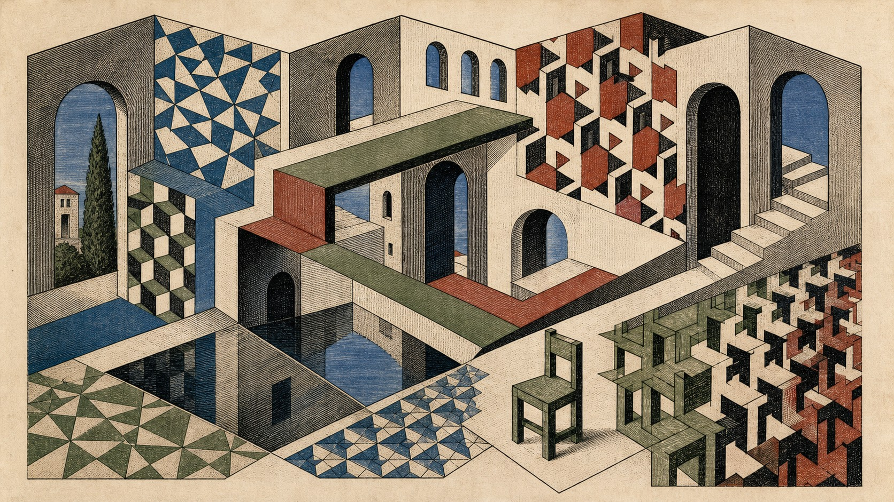

# 莫里茨·科内利斯·埃舍尔

[English](README.en.md)

> **分类：** 艺术家  
> **媒介领域：** 版画  
> **目录：** `style-packages/artists/mc-escher`

## 简介

这个包提取精密线刻、连续镶嵌、错视空间、反射对称和形体变形。它适合把普通主体放进一套清晰的平面与空间规则里，再让其中一处关系自然地转向不可能。

它只改变视觉处理方式，不规定人物、物体、地点或故事。楼梯、塔楼、动物和著名构图都不是默认内容。

## 策展短评

埃舍尔的趣味不在于“画一个奇怪建筑”，而在于让每个局部都像是合理的，整体却在连接处悄悄改变规则。使用这个包时，我会先保住主体的可辨识度，再安排一处连续变形、镜像或镶嵌，让观看在理解和怀疑之间停留片刻。

## 主体独立性

你的主题、人物、物体、地点和叙事优先。本包只负责版画媒介、线条、平面组织、有限色彩、表面和空间转换。代表图中的几何庭院与座椅只是示例，不会自动出现在新的生成结果里。

## 使用前先看

- `identity.yaml`：范围与排除项
- `visual-signature.yaml`：换主体后仍应保留的视觉特征
- `reproduction.yaml`：媒介、材料和构建顺序
- `prompts/base.txt`、`prompts/negative.txt`：基础约束
- `palette/palette.json`：色彩角色
- `evaluation.yaml`：生成后的检查标准
- `references/manifest.csv`、`provenance.yaml`：来源与权利边界

## 来源与版权

作品介绍和收藏页面只用于研究可观察特征。外部作品及其图像权利仍归原权利人所有；本包不捆绑外部作品，也不复制某件作品的构图、人物、文字或标志。代表图是新的匿名场景，不代表与相关艺术家或机构存在合作、授权或背书关系。

来源： [海牙市立博物馆的埃舍尔收藏介绍](https://www.kunstmuseum.nl/en/collections/escher)。详细边界见 [`provenance.yaml`](provenance.yaml)、[`references/manifest.csv`](references/manifest.csv) 和仓库根目录的 [`NOTICE`](../../../NOTICE)。

## 只使用此包

### 方式一：交给有生图能力的 Agent

把本目录上传给 Agent，或提供本地路径，并告诉它：先读取 `identity.yaml`、`visual-signature.yaml`、`reproduction.yaml`、`prompts/base.txt`、`prompts/negative.txt`、`palette/palette.json` 和 `evaluation.yaml`，再把你的主题编译成完整 Prompt。如果任务要表现一个局部空间悖论，再显式读取 `art-direction.yaml`，声明 `single-impossible-junction` 上下文。要求它只使用包中的视觉规则，不添加楼梯、塔楼、动物等固定题材，并在生成后按 `evaluation.yaml` 检查。

### 方式二：直接复制 Prompt

打开 `prompts/base.txt`，替换主题、地点和画幅；把 `prompts/negative.txt` 一并作为负面约束。需要单一局部悖论时，用 `--direction package --context single-impossible-junction` 显式启用新版方向。旧版默认路径不变。

### 方式三：配置 API Key 后提交生成

在你自己的生图平台或编译工具中配置 API Key，再提交基础 Prompt、负面约束、调色板和必要的参考清单。本仓库不托管密钥，也不提供在线生图服务。

### 方式四：本地模型 + ComfyUI

把基础 Prompt 和负面约束接入本地模型或 ComfyUI 工作流，按复现说明设置线条、平面、材质和有限色彩，生成后用 `evaluation.yaml` 复核。

模型权重、密钥和生成图片由使用者自行管理。参考资料用于理解特征，不用于复制原作。
## 实验方向：单一不可能连接

包现包含一个可显式选择的实验方向 [`art-direction.yaml`](art-direction.yaml)，使用方向格式 2.1.0：只在用户指定的普通物体或结构中设置一个局部空间悖论，其他连接和背景保持一致透视。只有用户要求版画处理时，才声明 `user-requests-printmaking-treatment` 启用刻线规则。它不默认加入楼梯、塔楼、动物或风景，也不复制任何著名构图。

对照图和编译记录见 [`comparisons/`](comparisons/README.md)。这是一条文本生图路线，不能保证几何精确；样图需检查连接处的边线、深度顺序与物体可辨识度。
