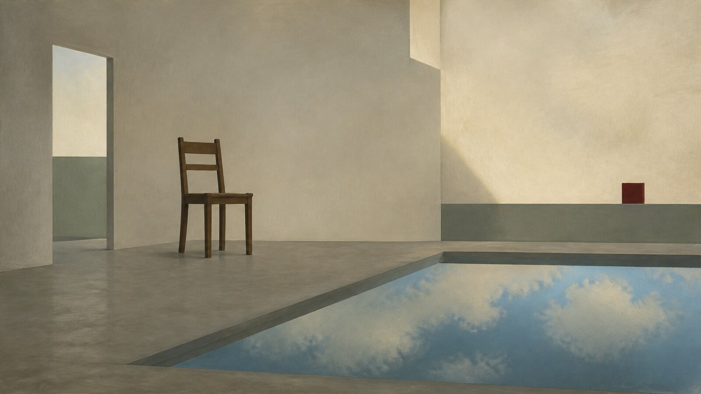

# René Magritte

[中文版](README.md)

> **Category:** artist
> **Domain:** painting
> **Path:** style-packages/artists/rene-magritte

## Overview

A calm naturalistic surface turns ordinary objects into uncanny, scale-shifted and logically impossible images.

This is an independently usable style package. It extracts observable visual language for new user-supplied subjects; objects, places, people, and stories in the representative image are not default requirements.

## Curatorial note

The quiet surface is the point: the clearer the object looks, the more forcefully the impossible relationship emerges. Let the image feel believable first, then leave one precise contradiction unresolved.

## Subject independence

This package controls how an image is generated, not what it depicts. The user's people, objects, places, architecture, plants, vehicles, and narrative remain authoritative. The representative image demonstrates visual treatment only.

## Sources and rights

References are used for research and visual analysis. External artworks, photographs, game imagery, trademarks, and platform pages remain the property of their respective rights holders. The generated example is a new anonymous scene and is not an original work by, or an endorsement from, the referenced artist, movement, technique, or game.

See provenance.yaml and references/manifest.csv for source boundaries.

## Use only this package

### Method 1: Give the package to an image-capable Agent

Give this directory to an Agent and ask it to read identity.yaml, visual-signature.yaml, reproduction.yaml, prompts/base.txt, prompts/negative.txt, palette/palette.json, and evaluation.yaml before compiling your subject, location, aspect ratio, and purpose into a full prompt. Ask it to check the result against evaluation.yaml and never copy a reference work.

### Method 2: Copy the prompts

Open prompts/base.txt, replace the subject, location, and aspect-ratio requirement, then send prompts/negative.txt with it when the image service supports negative prompts.

### Method 3: Configure an API key and submit

Use your own image platform or compiler. Submit the base prompt, negative constraints, palette, and reference manifest together. You manage keys and generated images; this repository does not host an image service.

### Method 4: Local model and ComfyUI

Connect the base prompt and negative constraints to a local model or ComfyUI workflow. Use visual-signature.yaml, reproduction.yaml, and palette/palette.json to set visual parameters, then review the output with evaluation.yaml.

## Experimental direction: object and shadow mismatch

The optional [`art-direction.yaml`](art-direction.yaml) uses direction format 2.1.0 and applies only when the user explicitly declares `user-requested-shadow-paradox`. Keep the object naturalistic and clear; ground its shadow on the same surface under one coherent light source, while letting the outline take the other form specified by the user. Add `ordinary-object-with-contrasting-shadow` only when that object-shadow comparison is part of the brief to activate the surface rule. It does not add a physical copy of the shadow form or classic motifs by default. See [`comparisons/`](comparisons/README.md) for a generated comparison. This direction remains experimental.
